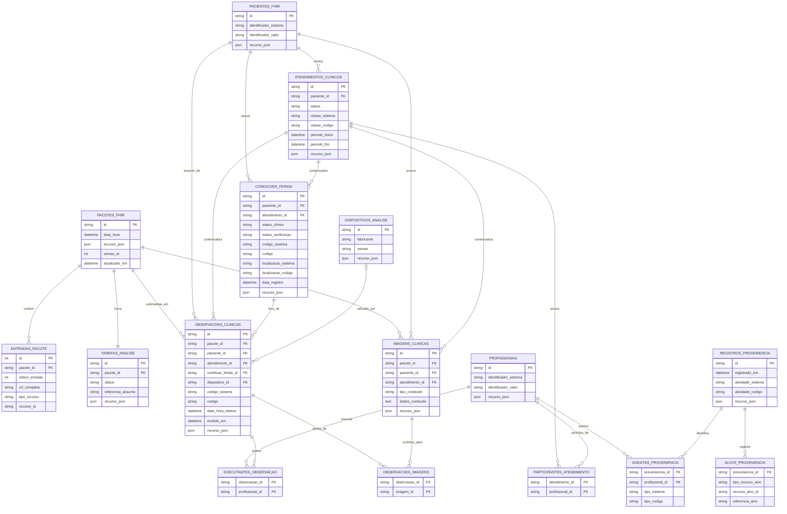

# Mapeamento FHIR R4 dos requisitos clínicos de entrada

**Fonte:** Quadro 1 de `requisitos_clinicos_v1.0.html`  
**Escopo:** contrato de intake de avaliações clínicas de feridas da API HealPlus.  
**Versão normativa:** FHIR R4 4.0.1.

## Status atual de implementação (2026-10-21)

### Implementado na branch atual

- Operação de sistema `POST /api/fhir/r4/$avaliar-feridas` com `Parameters`
  contendo `Bundle.type = collection`.
- Schemas clínicos em `schemas/avaliacao_ferida.py` com validação estrutural e
  semântica das referências internas do Bundle.
- Persistência transacional de `Bundle`, `Media` e `Task`, além da tabela
  `entradas_pacote` para rastreabilidade de todas as entradas do Bundle.
- Leituras FHIR para `Task`, `Bundle`, `Media`, `Encounter`, `Condition` e
  `Observation`.
- Publicação de `CapabilityStatement`, `OperationDefinition` e perfis
  `StructureDefinition` do escopo clínico HealPlus.
- Suíte automatizada atual com `13` testes passando em `pytest -q`.

### Pendências em relação ao estado-alvo desta especificação

- A modelagem relacional clínica completa da seção 8.3 (tabelas dedicadas para
  `Patient`, `Practitioner`, `Encounter`, `Condition`, `Observation`,
  `Provenance` e associações) ainda não foi materializada; neste momento os
  recursos não-`Media` são preservados e consultados por `entradas_pacote`.
- O requisito de política de autenticação/autorização/auditoria para exposição
  de dados clínicos sensíveis permanece como pré-requisito de hardening para
  evolução do escopo de leitura.

## 1. Decisões de interoperabilidade

O recurso clínico principal é `Condition`: uma instância representa **uma
ferida**. `Encounter` registra o contexto assistencial em que a avaliação foi
realizada; não substitui a ferida e não deve ser usado como seu identificador.
`Observation` representa medições e constatações pontuais da avaliação;
`Media` representa a fotografia clínica.

O payload de uma operação FHIR usa `Parameters`, recurso destinado à passagem
de parâmetros de operação e que, neste contrato, não é persistido
separadamente. Seu parâmetro `bundle` contém um `Bundle.type = collection`,
que agrupa recursos independentes e referenciais. O Bundle **não** é uma
transação REST.

Fontes normativas:

- [Parameters R4](https://hl7.org/fhir/R4/parameters.html)
- [Bundle R4](https://hl7.org/fhir/R4/bundle.html)
- [Encounter R4](https://hl7.org/fhir/R4/encounter.html)
- [Condition R4](https://hl7.org/fhir/R4/condition.html)
- [Observation R4](https://hl7.org/fhir/R4/observation.html)
- [Media R4](https://hl7.org/fhir/R4/media.html)
- [Provenance R4](https://hl7.org/fhir/R4/provenance.html)

## 2. Modelo de relacionamento

```text
Parameters
└── Bundle (collection)
    ├── Patient
    ├── Practitioner
    ├── Encounter ────────── subject ───────► Patient
    ├── Device ───────────── usado por ─────► Observation assistiva
    ├── Condition (ferida) ─ subject ───────► Patient
    │                         encounter ────► Encounter
    ├── Media ────────────── subject ───────► Patient
    │                         encounter ────► Encounter
    ├── Observation (*) ──── subject ───────► Patient
    │                         encounter ────► Encounter
    │                         focus ────────► Condition (ferida)
    │                         derivedFrom ──► Media
    └── Provenance ───────── target ────────► recursos do Bundle
                              agent.who ────► Practitioner
```

Em FHIR R4, `Media` não possui uma referência nativa para `Condition`.
A associação entre fotografia e ferida é garantida por:

1. `Media.subject` e `Media.encounter` iguais aos da avaliação;
2. `Media.bodySite` compatível com `Condition.bodySite`; e
3. `Observation.focus` referenciando a ferida e `Observation.derivedFrom`
   referenciando a fotografia utilizada.

Referências entre entradas do Bundle usam `urn:uuid:<uuid RFC 4122>` em
`Bundle.entry.fullUrl`. Cada `fullUrl` deve ser único, conforme a regra R4
`bdl-7`.

## 3. Matriz de rastreabilidade do Quadro 1

| ID | Informação clínica | Recurso FHIR R4 | Regra HealPlus |
|---|---|---|---|
| RC01a | Identificação do paciente | `Patient.identifier`, referência em `subject` | Um único paciente por Bundle. É obrigatório um identificador mínimo; nome, endereço e demais dados identificáveis não são necessários. |
| RC02a | Histórico relevante | `Condition` | A ferida é uma `Condition` distinta; comorbidades relevantes são `Condition` separados. Data de início, estado clínico e contexto são registrados no recurso. |
| RC03a | Localização anatômica | `Condition.bodySite` | Um `CodeableConcept` anatômico é obrigatório. |
| RC04a | Tipo de ferida | `Condition.code`, `Condition.category` | O tipo é informado pelo profissional e nunca inferido da fotografia. |
| RC05a | Dimensões | `Observation` | Comprimento e largura são obrigatórios; profundidade é obrigatória quando mensurável. Valores usam `Quantity` e UCUM. |
| RC06a | Tecido predominante | `Observation` | Registra tecido predominante, percentuais por tecido e percentual não classificado. |
| RC07a | Sinais de infecção | `Observation` | Registra sinais observados; não produz diagnóstico de infecção. |
| RC08a | Exsudato | `Observation` | Registra presença, quantidade e aspecto informado pelo profissional. |
| RC09a | Dor | `Observation` | Opcional, conforme o Quadro 1. Não pode ser inferida a partir de imagem. |
| RC10a | Bordas | `Observation` | Registra as características observadas nas bordas. |
| RC11a | Pele ao redor | `Observation` | Registra as condições observadas na pele perilesional. |
| RC12a | Imagens padronizadas | `Media` e `Observation` | `Media` contém a imagem; uma `Observation` complementar registra a qualidade da captura. |

## 4. Perfis HealPlus e atributos

Os perfis devem ser publicados como `StructureDefinition`, com URL canônica
`https://healplus.com.br/fhir/StructureDefinition/<nome-do-perfil>`. A coluna
**Card.** é a cardinalidade imposta pelo perfil, não necessariamente a
cardinalidade do recurso base.

Cada perfil HealPlus usa `id` e `name` no formato `HealPlus` + PascalCase sem
acentos, URL canônica com o mesmo identificador, `title` e `description` em
pt-BR e `language = "pt-BR"`.

| Perfil HealPlus | Recurso FHIR R4 base | Título em pt-BR | Finalidade |
|---|---|---|---|
| `HealPlusParametrosAvaliacaoFerida` | `Parameters` | Parâmetros da Avaliação de Ferida | Envelope da operação `$avaliar-feridas`. |
| `HealPlusAvaliacaoFerida` | `Bundle` | Bundle de Avaliação de Ferida | Agrupa todos os recursos clínicos de uma avaliação. |
| `HealPlusPaciente` | `Patient` | Paciente HealPlus | Restringe o paciente ao identificador mínimo necessário ao intake. |
| `HealPlusAtendimentoAvaliacaoFerida` | `Encounter` | Atendimento de Avaliação de Ferida | Contextualiza a avaliação presencial. |
| `HealPlusFerida` | `Condition` | Ferida HealPlus | Representa uma ferida individual, seu tipo, localização e estado clínico. |
| `HealPlusImagemClinica` | `Media` | Imagem Clínica HealPlus | Representa a fotografia JPEG associada à avaliação. |
| `HealPlusDispositivoAnalise` | `Device` | Dispositivo de Análise HealPlus | Identifica o dispositivo ou modelo utilizado em resultado assistivo. |
| `HealPlusProvenienciaAvaliacao` | `Provenance` | Proveniência da Avaliação | Registra autoria, origem e instante da submissão. |
| `HealPlusDimensoesFerida` | `Observation` | Dimensões da Ferida | Registra comprimento, largura, profundidade e área. |
| `HealPlusTecidoFerida` | `Observation` | Tecido da Ferida | Registra tecido predominante e composição tecidual. |
| `HealPlusSinaisInfeccaoFerida` | `Observation` | Sinais de Infecção da Ferida | Registra achados clínicos sem produzir diagnóstico. |
| `HealPlusExsudatoFerida` | `Observation` | Exsudato da Ferida | Registra presença, quantidade e aspecto do exsudato. |
| `HealPlusDorFerida` | `Observation` | Dor da Ferida | Registra dor relatada ou observada, quando disponível. |
| `HealPlusBordasFerida` | `Observation` | Bordas da Ferida | Registra características das bordas da lesão. |
| `HealPlusPelePerilesional` | `Observation` | Pele Perilesional | Registra condições da pele ao redor da ferida. |
| `HealPlusQualidadeCapturaImagem` | `Observation` | Qualidade da Captura de Imagem | Registra qualidade da fotografia clínica. |

### 4.1 Envelope da operação

| Perfil e elemento | Tipo de dado R4 | Card. | Restrição HealPlus |
|---|---|---:|---|
| `HealPlusParametrosAvaliacaoFerida.resourceType` | `code` | 1..1 | Fixo em `Parameters`. |
| `.parameter` | `BackboneElement` | 1..1 | Exatamente um parâmetro. |
| `.parameter.name` | `code` | 1..1 | Fixo em `bundle`. |
| `.parameter.resource` | `Resource` | 1..1 | Deve ser `Bundle` no perfil `HealPlusAvaliacaoFerida`. Não pode coexistir com `value[x]` ou `part`. |
| `HealPlusAvaliacaoFerida.resourceType` | `code` | 1..1 | Fixo em `Bundle`. |
| `.id` | `id` | 1..1 | Identificador FHIR do pacote submetido. |
| `.type` | `code` | 1..1 | Fixo em `collection`. |
| `.timestamp` | `instant` | 1..1 | Momento de montagem do Bundle. |
| `.entry` | `BackboneElement` | 1..* | Contém todos os recursos da avaliação. |
| `.entry.fullUrl` | `uri` | 1..1 | `urn:uuid:<uuid>` único no Bundle. |
| `.entry.resource` | `Resource` | 1..1 | Recurso permitido pela seção 5. `entry.request` e `entry.response` são proibidos em `collection`. |

### 4.2 Contexto clínico e rastreabilidade

| Perfil e elemento | Tipo de dado R4 | Card. | Restrição HealPlus |
|---|---|---:|---|
| `HealPlusPaciente.identifier` | `Identifier` | 1..* | Um identificador pseudonimizado ou institucional do paciente. |
| `HealPlusPaciente.identifier.system` | `uri` | 1..1 | Sistema emissor do identificador. |
| `HealPlusPaciente.identifier.value` | `string` | 1..1 | Valor do identificador. |
| `HealPlusAtendimentoAvaliacaoFerida.status` | `code` | 1..1 | Estado R4 do atendimento, por exemplo `finished`. |
| `.class` | `Coding` | 1..1 | Classe assistencial, por exemplo `AMB`. |
| `.subject` | `Reference(Patient)` | 1..1 | Mesmo paciente do Bundle. |
| `.period.start` | `dateTime` | 1..1 | Início do atendimento. |
| `.period.end` | `dateTime` | 0..1 | Fim, se conhecido. |
| `.participant.individual` | `Reference(Practitioner\|PractitionerRole\|RelatedPerson)` | 1..* | Profissional ou participante responsável. |
| `HealPlusFerida.subject` | `Reference(Patient)` | 1..1 | Mesmo paciente do Bundle. |
| `.encounter` | `Reference(Encounter)` | 1..1 | Atendimento da avaliação. Capturas remotas estão fora do escopo deste perfil. |
| `.clinicalStatus` | `CodeableConcept` | 1..1 | Estado clínico da ferida, por exemplo `active`. |
| `.verificationStatus` | `CodeableConcept` | 1..1 | Estado de confirmação, por exemplo `confirmed`. |
| `.category` | `CodeableConcept` | 1..* | Categoria local versionada `ferida`. |
| `.code` | `CodeableConcept` | 1..1 | Tipo de ferida informado pelo profissional. |
| `.bodySite` | `CodeableConcept` | 1..* | Localização anatômica codificada. |
| `.onset[x]` | `dateTime` | 0..1 | No perfil, quando informado, usa `onsetDateTime`. |
| `.recordedDate` | `dateTime` | 1..1 | Data de registro da condição. |
| `.recorder` | `Reference(Practitioner\|PractitionerRole\|Patient\|RelatedPerson)` | 1..1 | Autor do registro da ferida. |
| `.note` | `Annotation` | 0..* | Contexto relevante; `text` é `markdown`, `author[x]` e `time` devem ser preenchidos quando disponíveis. |
| `HealPlusImagemClinica.status` | `code` | 1..1 | Fixo em `completed` para fotografia pronta. |
| `.type` | `CodeableConcept` | 1..1 | Deve incluir `media-type#image`. |
| `.subject` | `Reference(Patient)` | 1..1 | Mesmo paciente do Bundle. |
| `.encounter` | `Reference(Encounter)` | 1..1 | Mesmo atendimento da avaliação. |
| `.created[x]` | `dateTime` | 1..1 | No perfil, usa `createdDateTime`. |
| `.operator` | `Reference(Practitioner\|PractitionerRole\|Organization\|CareTeam\|Patient\|Device\|RelatedPerson)` | 1..1 | Responsável pela captura. |
| `.bodySite` | `CodeableConcept` | 1..1 | Compatível com a localização da ferida. |
| `.content` | `Attachment` | 1..1 | Conteúdo da fotografia. |
| `.content.contentType` | `code` | 1..1 | Fixo em `image/jpeg`. |
| `.content.data` | `base64Binary` | 1..1 | JPEG em Base64. A API não aceita URL externa neste perfil. |
| `.content.hash` | `base64Binary` | 0..1 | Hash da imagem quando disponibilizado pelo cliente. |
| `HealPlusDispositivoAnalise.status` | `code` | 1..1 | Estado do dispositivo; `active` para modelo disponível. |
| `.manufacturer` | `string` | 1..1 | Responsável pelo dispositivo ou modelo. |
| `.deviceName.name` | `string` | 1..1 | Nome do dispositivo ou modelo. |
| `.deviceName.type` | `code` | 1..1 | Fixo em `user-friendly-name`. |
| `.version` | `string` | 1..1 | Versão reprodutível do modelo ou dispositivo. |
| `HealPlusProvenienciaAvaliacao.target` | `Reference(Any)` | 1..* | Recursos de entrada produzidos na mesma atividade. |
| `.recorded` | `instant` | 1..1 | Momento em que a atividade foi registrada. |
| `.activity` | `CodeableConcept` | 1..1 | Atividade local versionada `captura-dados-clinicos`. |
| `.agent` | `BackboneElement` | 1..* | Agente que participou da atividade. |
| `.agent.type` | `CodeableConcept` | 1..1 | Papel, por exemplo `author`. |
| `.agent.who` | `Reference(Practitioner\|PractitionerRole\|Organization\|Patient\|RelatedPerson\|Device)` | 1..1 | Agente responsável. |

### 4.3 Base comum das observações

Os oito perfis de `Observation` da seção 4.4 compartilham os elementos abaixo.

| Elemento | Tipo de dado R4 | Card. | Restrição HealPlus |
|---|---|---:|---|
| `resourceType` | `code` | 1..1 | Fixo em `Observation`. |
| `status` | `code` | 1..1 | `final` para registro validado pelo profissional; `preliminary` somente antes da revisão. |
| `category` | `CodeableConcept` | 1..* | Deve incluir `observation-category#exam`. |
| `code` | `CodeableConcept` | 1..1 | Código local HealPlus que identifica o tipo da observação. |
| `subject` | `Reference(Patient)` | 1..1 | Mesmo paciente do Bundle. |
| `encounter` | `Reference(Encounter)` | 1..1 | Mesmo atendimento da avaliação. |
| `focus` | `Reference(Condition)` | 1..1 | A `Condition` que representa a ferida. |
| `effective[x]` | `dateTime` | 1..1 | No perfil, usa `effectiveDateTime`: instante clínico da avaliação. |
| `issued` | `instant` | 1..1 | Instante de emissão do registro. |
| `performer` | `Reference(Practitioner\|PractitionerRole\|Organization\|CareTeam\|Patient\|RelatedPerson)` | 1..* | Responsável pela observação. |
| `bodySite` | `CodeableConcept` | 1..1 | Compatível com `Condition.bodySite`. |
| `method` | `CodeableConcept` | 0..1 | Método aplicado, como avaliação visual, medição manual ou análise assistiva. |
| `device` | `Reference(Device\|DeviceMetric)` | 0..1 | Obrigatório se o resultado foi gerado por dispositivo ou modelo computacional. |
| `derivedFrom` | `Reference(Observation\|QuestionnaireResponse\|MolecularSequence\|DocumentReference\|ImagingStudy\|Media)` | 0..* | Referência ao `Media` somente quando a foto contribuiu para o resultado. |
| `note` | `Annotation` | 0..* | Observação contextual do profissional; não substitui elemento estruturado. |
| `component` | `BackboneElement` | 0..* | Componentes específicos da seção 4.4. |
| `component.code` | `CodeableConcept` | 1..1 | Deve conter `Coding` do CodeSystem HealPlus aplicável, com código fixado pelo perfil. |
| `component.value[x]` | `Quantity`, `CodeableConcept`, `boolean` ou `integer` | 0..1 | Tipo definido para cada componente. |
| `component.dataAbsentReason` | `CodeableConcept` | 0..1 | Obrigatório quando um componente clínico aplicável não tiver valor. |

### 4.4 Componentes dos perfis de `Observation`

Os códigos de `Observation.code` e dos respectivos componentes pertencem ao
`CodeSystem` versionado
`https://healplus.com.br/fhir/CodeSystem/avaliacao-ferida`. Valores clínicos
codificados, como tipo de ferida e tecido predominante, usam o CodeSystem
HealPlus específico indicado no perfil. O conjunto final de valores deve ser
validado pela equipe clínica antes da implementação.

| Perfil | `Observation.code` | Atributos adicionais e tipo de dado |
|---|---|---|
| `HealPlusDimensoesFerida` | `dimensoes-ferida` | `component[comprimento]`, `component[largura]`, `component[profundidade]` e `component[area]`: `Quantity`. Comprimento e largura usam UCUM `cm`; profundidade usa `cm`; área usa `cm2`. Profundidade não mensurável usa `dataAbsentReason`. |
| `HealPlusTecidoFerida` | `tecido-ferida` | `valueCodeableConcept`: tecido predominante. Componentes `percentual-granulacao`, `percentual-necrose`, `percentual-esfacelo`, `percentual-epitelizacao` e `percentual-nao-classificado`: `Quantity` em `%`. Quando houver análise computacional, `method` e `device` identificam sua origem. |
| `HealPlusSinaisInfeccaoFerida` | `sinais-infeccao-ferida` | Componentes `odor`, `eritema`, `calor`, `dor-aumentada`, `secrecao`, `piora-visual` e `edema`: `boolean`. Estes valores são achados e não um diagnóstico. |
| `HealPlusExsudatoFerida` | `exsudato-ferida` | Componentes `presente`: `boolean`; `quantidade`, `aspecto`, `cor` e `consistencia`: `CodeableConcept`; `odor-avaliado`: `boolean`. |
| `HealPlusDorFerida` | `dor-ferida` | Opcional. `valueInteger`: intensidade; `method`: escala utilizada; `note`: origem do dado, relato do paciente ou observação profissional. |
| `HealPlusBordasFerida` | `bordas-ferida` | Componentes `maceracao`, `descolamento`, `epitelizacao`, `hiperqueratose` e `irregularidade`: `boolean`. |
| `HealPlusPelePerilesional` | `pele-perilesional` | Componentes `eritema`, `edema`, `maceracao`, `ressecamento`, `descamacao` e `irritacao`: `boolean`; `distancia-afetada`: `Quantity` em `cm`. |
| `HealPlusQualidadeCapturaImagem` | `qualidade-captura-imagem` | Componentes `foco`, `iluminacao`, `enquadramento`, `distancia-padronizada` e `repetivel`: `CodeableConcept`; `escala-presente` e `privacidade-revisada`: `boolean`. `derivedFrom` é obrigatório e referencia um `Media`. |

## 5. Validações entre recursos

1. O Bundle deve conter exatamente um `Patient`, um `Practitioner`, um
   `Encounter`, uma `Condition` no perfil `HealPlusFerida` e um `Provenance`;
   pode conter `Condition` adicionais para comorbidades relevantes. Deve conter
   ao menos um `Media`, uma `Observation` para cada um dos sete perfis
   obrigatórios (dimensões, tecido, sinais de infecção, exsudato, bordas, pele
   perilesional e qualidade da captura) e, opcionalmente, uma `Observation` de
   dor.
2. Captura remota sem `Encounter` está fora do escopo deste contrato e requer
   perfil e regras de proveniência próprios em uma especificação futura.
3. Todo `Observation.subject` deve referenciar o Patient; todo
   `Observation.focus` deve referenciar a Condition; todo
   `Observation.encounter`, quando presente, deve referenciar o mesmo Encounter.
4. A data da fotografia (`Media.createdDateTime`) e a data clínica
   (`Observation.effectiveDateTime`) são independentes e ambas devem ser
   preservadas.
5. `Observation.derivedFrom` somente pode referenciar um `Media` do mesmo
   paciente, atendimento e localização anatômica compatível.
6. A composição tecidual não classificada deve estar presente sempre que a
   soma dos demais percentuais for inferior a 100%.
7. Resultados assistivos não podem inferir dor, diagnosticar infecção, definir
   conduta, prescrever tratamento ou estagiar automaticamente a lesão.

## 6. Payload completo de exemplo

O payload abaixo representa uma avaliação presencial. Ele contém todos os
requisitos RC01a–RC12a e inclui RC09a (dor), embora seja opcional. Os códigos
HealPlus são ilustrativos e precisam ser formalizados nos `ValueSet` e
`CodeSystem` publicados.

```json
{
  "resourceType": "Parameters",
  "meta": {
    "profile": [
      "https://healplus.com.br/fhir/StructureDefinition/HealPlusParametrosAvaliacaoFerida"
    ]
  },
  "parameter": [
    {
      "name": "bundle",
      "resource": {
        "resourceType": "Bundle",
        "id": "assessment-20261019-001",
        "meta": {
          "profile": [
            "https://healplus.com.br/fhir/StructureDefinition/HealPlusAvaliacaoFerida"
          ]
        },
        "type": "collection",
        "timestamp": "2026-10-19T22:10:00Z",
        "entry": [
          {
            "fullUrl": "urn:uuid:10000000-0000-4000-8000-000000000001",
            "resource": {
              "resourceType": "Patient",
              "id": "patient-001",
              "meta": {
                "profile": [
                  "https://healplus.com.br/fhir/StructureDefinition/HealPlusPaciente"
                ]
              },
              "identifier": [
                {
                  "system": "https://healplus.com.br/fhir/NamingSystem/paciente",
                  "value": "PSEUD-00001"
                }
              ]
            }
          },
          {
            "fullUrl": "urn:uuid:20000000-0000-4000-8000-000000000001",
            "resource": {
              "resourceType": "Practitioner",
              "id": "practitioner-001",
              "identifier": [
                {
                  "system": "https://healplus.com.br/fhir/NamingSystem/profissional",
                  "value": "PROF-00001"
                }
              ]
            }
          },
          {
            "fullUrl": "urn:uuid:30000000-0000-4000-8000-000000000001",
            "resource": {
              "resourceType": "Device",
              "id": "device-001",
              "meta": {
                "profile": [
                  "https://healplus.com.br/fhir/StructureDefinition/HealPlusDispositivoAnalise"
                ]
              },
              "status": "active",
              "manufacturer": "HealPlus",
              "deviceName": [
                {
                  "name": "Segmentação de tecido HealPlus",
                  "type": "user-friendly-name"
                }
              ],
              "version": "1.0.0"
            }
          },
          {
            "fullUrl": "urn:uuid:40000000-0000-4000-8000-000000000001",
            "resource": {
              "resourceType": "Encounter",
              "id": "encounter-001",
              "meta": {
                "profile": [
                  "https://healplus.com.br/fhir/StructureDefinition/HealPlusAtendimentoAvaliacaoFerida"
                ]
              },
              "status": "finished",
              "class": {
                "system": "http://terminology.hl7.org/CodeSystem/v3-ActCode",
                "code": "AMB",
                "display": "Ambulatorial"
              },
              "subject": {
                "reference": "urn:uuid:10000000-0000-4000-8000-000000000001"
              },
              "period": {
                "start": "2026-10-19T21:50:00Z",
                "end": "2026-10-19T22:10:00Z"
              },
              "participant": [
                {
                  "individual": {
                    "reference": "urn:uuid:20000000-0000-4000-8000-000000000001"
                  }
                }
              ]
            }
          },
          {
            "fullUrl": "urn:uuid:50000000-0000-4000-8000-000000000001",
            "resource": {
              "resourceType": "Condition",
              "id": "wound-001",
              "meta": {
                "profile": [
                  "https://healplus.com.br/fhir/StructureDefinition/HealPlusFerida"
                ]
              },
              "clinicalStatus": {
                "coding": [
                  {
                    "system": "http://terminology.hl7.org/CodeSystem/condition-clinical",
                    "code": "active"
                  }
                ]
              },
              "verificationStatus": {
                "coding": [
                  {
                    "system": "http://terminology.hl7.org/CodeSystem/condition-ver-status",
                    "code": "confirmed"
                  }
                ]
              },
              "category": [
                {
                  "coding": [
                    {
                      "system": "https://healplus.com.br/fhir/CodeSystem/categoria-condicao",
                      "code": "ferida"
                    }
                  ]
                }
              ],
              "code": {
                "coding": [
                  {
                    "system": "https://healplus.com.br/fhir/CodeSystem/tipo-ferida",
                    "code": "ulcera-venosa",
                    "display": "Úlcera venosa"
                  }
                ]
              },
              "subject": {
                "reference": "urn:uuid:10000000-0000-4000-8000-000000000001"
              },
              "encounter": {
                "reference": "urn:uuid:40000000-0000-4000-8000-000000000001"
              },
              "onsetDateTime": "2026-08-01",
              "recordedDate": "2026-10-19T22:00:00Z",
              "recorder": {
                "reference": "urn:uuid:20000000-0000-4000-8000-000000000001"
              },
              "bodySite": [
                {
                  "coding": [
                    {
                      "system": "https://healplus.com.br/fhir/CodeSystem/localizacao-anatomica",
                      "code": "maleolo-medial-esquerdo",
                      "display": "Maléolo medial esquerdo"
                    }
                  ]
                }
              ],
              "note": [
                {
                  "authorReference": {
                    "reference": "urn:uuid:20000000-0000-4000-8000-000000000001"
                  },
                  "time": "2026-10-19T22:00:00Z",
                  "text": "Recorrência relatada; sem alteração de conduta neste intake."
                }
              ]
            }
          },
          {
            "fullUrl": "urn:uuid:60000000-0000-4000-8000-000000000001",
            "resource": {
              "resourceType": "Media",
              "id": "media-001",
              "meta": {
                "profile": [
                  "https://healplus.com.br/fhir/StructureDefinition/HealPlusImagemClinica"
                ]
              },
              "status": "completed",
              "type": {
                "coding": [
                  {
                    "system": "http://terminology.hl7.org/CodeSystem/media-type",
                    "code": "image"
                  }
                ]
              },
              "subject": {
                "reference": "urn:uuid:10000000-0000-4000-8000-000000000001"
              },
              "encounter": {
                "reference": "urn:uuid:40000000-0000-4000-8000-000000000001"
              },
              "createdDateTime": "2026-10-19T21:55:00Z",
              "operator": {
                "reference": "urn:uuid:20000000-0000-4000-8000-000000000001"
              },
              "bodySite": {
                "coding": [
                  {
                    "system": "https://healplus.com.br/fhir/CodeSystem/localizacao-anatomica",
                    "code": "maleolo-medial-esquerdo"
                  }
                ]
              },
              "content": {
                "contentType": "image/jpeg",
                "data": "/9j/4AAQ"
              }
            }
          },
          {
            "fullUrl": "urn:uuid:70000000-0000-4000-8000-000000000001",
            "resource": {
              "resourceType": "Observation",
              "id": "obs-dimensions-001",
              "meta": {
                "profile": [
                  "https://healplus.com.br/fhir/StructureDefinition/HealPlusDimensoesFerida"
                ]
              },
              "status": "final",
              "category": [{ "coding": [{ "system": "http://terminology.hl7.org/CodeSystem/observation-category", "code": "exam" }] }],
              "code": { "coding": [{ "system": "https://healplus.com.br/fhir/CodeSystem/avaliacao-ferida", "code": "dimensoes-ferida" }] },
              "subject": { "reference": "urn:uuid:10000000-0000-4000-8000-000000000001" },
              "encounter": { "reference": "urn:uuid:40000000-0000-4000-8000-000000000001" },
              "focus": [{ "reference": "urn:uuid:50000000-0000-4000-8000-000000000001" }],
              "effectiveDateTime": "2026-10-19T22:00:00Z",
              "issued": "2026-10-19T22:10:00Z",
              "performer": [{ "reference": "urn:uuid:20000000-0000-4000-8000-000000000001" }],
              "bodySite": { "coding": [{ "system": "https://healplus.com.br/fhir/CodeSystem/localizacao-anatomica", "code": "maleolo-medial-esquerdo" }] },
              "method": { "text": "Medição manual com régua métrica" },
              "derivedFrom": [{ "reference": "urn:uuid:60000000-0000-4000-8000-000000000001" }],
              "component": [
                { "code": { "coding": [{ "system": "https://healplus.com.br/fhir/CodeSystem/avaliacao-ferida", "code": "comprimento" }] }, "valueQuantity": { "value": 4.2, "unit": "cm", "system": "http://unitsofmeasure.org", "code": "cm" } },
                { "code": { "coding": [{ "system": "https://healplus.com.br/fhir/CodeSystem/avaliacao-ferida", "code": "largura" }] }, "valueQuantity": { "value": 2.1, "unit": "cm", "system": "http://unitsofmeasure.org", "code": "cm" } },
                { "code": { "coding": [{ "system": "https://healplus.com.br/fhir/CodeSystem/avaliacao-ferida", "code": "profundidade" }] }, "valueQuantity": { "value": 0.3, "unit": "cm", "system": "http://unitsofmeasure.org", "code": "cm" } },
                { "code": { "coding": [{ "system": "https://healplus.com.br/fhir/CodeSystem/avaliacao-ferida", "code": "area" }] }, "valueQuantity": { "value": 8.82, "unit": "cm2", "system": "http://unitsofmeasure.org", "code": "cm2" } }
              ]
            }
          },
          {
            "fullUrl": "urn:uuid:70000000-0000-4000-8000-000000000002",
            "resource": {
              "resourceType": "Observation",
              "id": "obs-tissue-001",
              "meta": { "profile": ["https://healplus.com.br/fhir/StructureDefinition/HealPlusTecidoFerida"] },
              "status": "final",
              "category": [{ "coding": [{ "system": "http://terminology.hl7.org/CodeSystem/observation-category", "code": "exam" }] }],
              "code": { "coding": [{ "system": "https://healplus.com.br/fhir/CodeSystem/avaliacao-ferida", "code": "tecido-ferida" }] },
              "subject": { "reference": "urn:uuid:10000000-0000-4000-8000-000000000001" },
              "encounter": { "reference": "urn:uuid:40000000-0000-4000-8000-000000000001" },
              "focus": [{ "reference": "urn:uuid:50000000-0000-4000-8000-000000000001" }],
              "effectiveDateTime": "2026-10-19T22:00:00Z",
              "issued": "2026-10-19T22:10:00Z",
              "performer": [{ "reference": "urn:uuid:20000000-0000-4000-8000-000000000001" }],
              "bodySite": { "coding": [{ "system": "https://healplus.com.br/fhir/CodeSystem/localizacao-anatomica", "code": "maleolo-medial-esquerdo" }] },
              "method": { "text": "Segmentação assistiva por imagem" },
              "device": { "reference": "urn:uuid:30000000-0000-4000-8000-000000000001" },
              "derivedFrom": [{ "reference": "urn:uuid:60000000-0000-4000-8000-000000000001" }],
              "valueCodeableConcept": { "coding": [{ "system": "https://healplus.com.br/fhir/CodeSystem/tecido-ferida", "code": "granulacao" }] },
              "component": [
                { "code": { "coding": [{ "system": "https://healplus.com.br/fhir/CodeSystem/avaliacao-ferida", "code": "percentual-granulacao" }] }, "valueQuantity": { "value": 65, "unit": "%", "system": "http://unitsofmeasure.org", "code": "%" } },
                { "code": { "coding": [{ "system": "https://healplus.com.br/fhir/CodeSystem/avaliacao-ferida", "code": "percentual-necrose" }] }, "valueQuantity": { "value": 0, "unit": "%", "system": "http://unitsofmeasure.org", "code": "%" } },
                { "code": { "coding": [{ "system": "https://healplus.com.br/fhir/CodeSystem/avaliacao-ferida", "code": "percentual-esfacelo" }] }, "valueQuantity": { "value": 20, "unit": "%", "system": "http://unitsofmeasure.org", "code": "%" } },
                { "code": { "coding": [{ "system": "https://healplus.com.br/fhir/CodeSystem/avaliacao-ferida", "code": "percentual-epitelizacao" }] }, "valueQuantity": { "value": 10, "unit": "%", "system": "http://unitsofmeasure.org", "code": "%" } },
                { "code": { "coding": [{ "system": "https://healplus.com.br/fhir/CodeSystem/avaliacao-ferida", "code": "percentual-nao-classificado" }] }, "valueQuantity": { "value": 5, "unit": "%", "system": "http://unitsofmeasure.org", "code": "%" } }
              ]
            }
          },
          {
            "fullUrl": "urn:uuid:70000000-0000-4000-8000-000000000003",
            "resource": {
              "resourceType": "Observation",
              "id": "obs-infection-signs-001",
              "meta": { "profile": ["https://healplus.com.br/fhir/StructureDefinition/HealPlusSinaisInfeccaoFerida"] },
              "status": "final",
              "category": [{ "coding": [{ "system": "http://terminology.hl7.org/CodeSystem/observation-category", "code": "exam" }] }],
              "code": { "coding": [{ "system": "https://healplus.com.br/fhir/CodeSystem/avaliacao-ferida", "code": "sinais-infeccao-ferida" }] },
              "subject": { "reference": "urn:uuid:10000000-0000-4000-8000-000000000001" },
              "encounter": { "reference": "urn:uuid:40000000-0000-4000-8000-000000000001" },
              "focus": [{ "reference": "urn:uuid:50000000-0000-4000-8000-000000000001" }],
              "effectiveDateTime": "2026-10-19T22:00:00Z",
              "issued": "2026-10-19T22:10:00Z",
              "performer": [{ "reference": "urn:uuid:20000000-0000-4000-8000-000000000001" }],
              "bodySite": { "coding": [{ "system": "https://healplus.com.br/fhir/CodeSystem/localizacao-anatomica", "code": "maleolo-medial-esquerdo" }] },
              "component": [
                { "code": { "coding": [{ "system": "https://healplus.com.br/fhir/CodeSystem/avaliacao-ferida", "code": "odor" }] }, "valueBoolean": false },
                { "code": { "coding": [{ "system": "https://healplus.com.br/fhir/CodeSystem/avaliacao-ferida", "code": "eritema" }] }, "valueBoolean": true },
                { "code": { "coding": [{ "system": "https://healplus.com.br/fhir/CodeSystem/avaliacao-ferida", "code": "calor" }] }, "valueBoolean": false },
                { "code": { "coding": [{ "system": "https://healplus.com.br/fhir/CodeSystem/avaliacao-ferida", "code": "dor-aumentada" }] }, "valueBoolean": false },
                { "code": { "coding": [{ "system": "https://healplus.com.br/fhir/CodeSystem/avaliacao-ferida", "code": "secrecao" }] }, "valueBoolean": false },
                { "code": { "coding": [{ "system": "https://healplus.com.br/fhir/CodeSystem/avaliacao-ferida", "code": "piora-visual" }] }, "valueBoolean": false },
                { "code": { "coding": [{ "system": "https://healplus.com.br/fhir/CodeSystem/avaliacao-ferida", "code": "edema" }] }, "valueBoolean": true }
              ]
            }
          },
          {
            "fullUrl": "urn:uuid:70000000-0000-4000-8000-000000000004",
            "resource": {
              "resourceType": "Observation",
              "id": "obs-exudate-001",
              "meta": { "profile": ["https://healplus.com.br/fhir/StructureDefinition/HealPlusExsudatoFerida"] },
              "status": "final",
              "category": [{ "coding": [{ "system": "http://terminology.hl7.org/CodeSystem/observation-category", "code": "exam" }] }],
              "code": { "coding": [{ "system": "https://healplus.com.br/fhir/CodeSystem/avaliacao-ferida", "code": "exsudato-ferida" }] },
              "subject": { "reference": "urn:uuid:10000000-0000-4000-8000-000000000001" },
              "encounter": { "reference": "urn:uuid:40000000-0000-4000-8000-000000000001" },
              "focus": [{ "reference": "urn:uuid:50000000-0000-4000-8000-000000000001" }],
              "effectiveDateTime": "2026-10-19T22:00:00Z",
              "issued": "2026-10-19T22:10:00Z",
              "performer": [{ "reference": "urn:uuid:20000000-0000-4000-8000-000000000001" }],
              "bodySite": { "coding": [{ "system": "https://healplus.com.br/fhir/CodeSystem/localizacao-anatomica", "code": "maleolo-medial-esquerdo" }] },
              "component": [
                { "code": { "coding": [{ "system": "https://healplus.com.br/fhir/CodeSystem/avaliacao-ferida", "code": "presente" }] }, "valueBoolean": true },
                { "code": { "coding": [{ "system": "https://healplus.com.br/fhir/CodeSystem/avaliacao-ferida", "code": "quantidade" }] }, "valueCodeableConcept": { "coding": [{ "system": "https://healplus.com.br/fhir/CodeSystem/avaliacao-ferida", "code": "pequena" }] } },
                { "code": { "coding": [{ "system": "https://healplus.com.br/fhir/CodeSystem/avaliacao-ferida", "code": "aspecto" }] }, "valueCodeableConcept": { "coding": [{ "system": "https://healplus.com.br/fhir/CodeSystem/avaliacao-ferida", "code": "seroso" }] } },
                { "code": { "coding": [{ "system": "https://healplus.com.br/fhir/CodeSystem/avaliacao-ferida", "code": "cor" }] }, "valueCodeableConcept": { "coding": [{ "system": "https://healplus.com.br/fhir/CodeSystem/avaliacao-ferida", "code": "amarelo-palha" }] } },
                { "code": { "coding": [{ "system": "https://healplus.com.br/fhir/CodeSystem/avaliacao-ferida", "code": "consistencia" }] }, "valueCodeableConcept": { "coding": [{ "system": "https://healplus.com.br/fhir/CodeSystem/avaliacao-ferida", "code": "fluido" }] } },
                { "code": { "coding": [{ "system": "https://healplus.com.br/fhir/CodeSystem/avaliacao-ferida", "code": "odor-avaliado" }] }, "valueBoolean": true }
              ]
            }
          },
          {
            "fullUrl": "urn:uuid:70000000-0000-4000-8000-000000000005",
            "resource": {
              "resourceType": "Observation",
              "id": "obs-pain-001",
              "meta": { "profile": ["https://healplus.com.br/fhir/StructureDefinition/HealPlusDorFerida"] },
              "status": "final",
              "category": [{ "coding": [{ "system": "http://terminology.hl7.org/CodeSystem/observation-category", "code": "exam" }] }],
              "code": { "coding": [{ "system": "https://healplus.com.br/fhir/CodeSystem/avaliacao-ferida", "code": "dor-ferida" }] },
              "subject": { "reference": "urn:uuid:10000000-0000-4000-8000-000000000001" },
              "encounter": { "reference": "urn:uuid:40000000-0000-4000-8000-000000000001" },
              "focus": [{ "reference": "urn:uuid:50000000-0000-4000-8000-000000000001" }],
              "effectiveDateTime": "2026-10-19T22:00:00Z",
              "issued": "2026-10-19T22:10:00Z",
              "performer": [{ "reference": "urn:uuid:20000000-0000-4000-8000-000000000001" }],
              "bodySite": { "coding": [{ "system": "https://healplus.com.br/fhir/CodeSystem/localizacao-anatomica", "code": "maleolo-medial-esquerdo" }] },
              "method": { "text": "Escala numérica de 0 a 10" },
              "valueInteger": 3,
              "note": [{ "text": "Dor relatada pela paciente." }]
            }
          },
          {
            "fullUrl": "urn:uuid:70000000-0000-4000-8000-000000000006",
            "resource": {
              "resourceType": "Observation",
              "id": "obs-edges-001",
              "meta": { "profile": ["https://healplus.com.br/fhir/StructureDefinition/HealPlusBordasFerida"] },
              "status": "final",
              "category": [{ "coding": [{ "system": "http://terminology.hl7.org/CodeSystem/observation-category", "code": "exam" }] }],
              "code": { "coding": [{ "system": "https://healplus.com.br/fhir/CodeSystem/avaliacao-ferida", "code": "bordas-ferida" }] },
              "subject": { "reference": "urn:uuid:10000000-0000-4000-8000-000000000001" },
              "encounter": { "reference": "urn:uuid:40000000-0000-4000-8000-000000000001" },
              "focus": [{ "reference": "urn:uuid:50000000-0000-4000-8000-000000000001" }],
              "effectiveDateTime": "2026-10-19T22:00:00Z",
              "issued": "2026-10-19T22:10:00Z",
              "performer": [{ "reference": "urn:uuid:20000000-0000-4000-8000-000000000001" }],
              "bodySite": { "coding": [{ "system": "https://healplus.com.br/fhir/CodeSystem/localizacao-anatomica", "code": "maleolo-medial-esquerdo" }] },
              "component": [
                { "code": { "coding": [{ "system": "https://healplus.com.br/fhir/CodeSystem/avaliacao-ferida", "code": "maceracao" }] }, "valueBoolean": false },
                { "code": { "coding": [{ "system": "https://healplus.com.br/fhir/CodeSystem/avaliacao-ferida", "code": "descolamento" }] }, "valueBoolean": false },
                { "code": { "coding": [{ "system": "https://healplus.com.br/fhir/CodeSystem/avaliacao-ferida", "code": "epitelizacao" }] }, "valueBoolean": true },
                { "code": { "coding": [{ "system": "https://healplus.com.br/fhir/CodeSystem/avaliacao-ferida", "code": "hiperqueratose" }] }, "valueBoolean": false },
                { "code": { "coding": [{ "system": "https://healplus.com.br/fhir/CodeSystem/avaliacao-ferida", "code": "irregularidade" }] }, "valueBoolean": false }
              ]
            }
          },
          {
            "fullUrl": "urn:uuid:70000000-0000-4000-8000-000000000007",
            "resource": {
              "resourceType": "Observation",
              "id": "obs-periwound-001",
              "meta": { "profile": ["https://healplus.com.br/fhir/StructureDefinition/HealPlusPelePerilesional"] },
              "status": "final",
              "category": [{ "coding": [{ "system": "http://terminology.hl7.org/CodeSystem/observation-category", "code": "exam" }] }],
              "code": { "coding": [{ "system": "https://healplus.com.br/fhir/CodeSystem/avaliacao-ferida", "code": "pele-perilesional" }] },
              "subject": { "reference": "urn:uuid:10000000-0000-4000-8000-000000000001" },
              "encounter": { "reference": "urn:uuid:40000000-0000-4000-8000-000000000001" },
              "focus": [{ "reference": "urn:uuid:50000000-0000-4000-8000-000000000001" }],
              "effectiveDateTime": "2026-10-19T22:00:00Z",
              "issued": "2026-10-19T22:10:00Z",
              "performer": [{ "reference": "urn:uuid:20000000-0000-4000-8000-000000000001" }],
              "bodySite": { "coding": [{ "system": "https://healplus.com.br/fhir/CodeSystem/localizacao-anatomica", "code": "maleolo-medial-esquerdo" }] },
              "component": [
                { "code": { "coding": [{ "system": "https://healplus.com.br/fhir/CodeSystem/avaliacao-ferida", "code": "eritema" }] }, "valueBoolean": true },
                { "code": { "coding": [{ "system": "https://healplus.com.br/fhir/CodeSystem/avaliacao-ferida", "code": "edema" }] }, "valueBoolean": true },
                { "code": { "coding": [{ "system": "https://healplus.com.br/fhir/CodeSystem/avaliacao-ferida", "code": "maceracao" }] }, "valueBoolean": false },
                { "code": { "coding": [{ "system": "https://healplus.com.br/fhir/CodeSystem/avaliacao-ferida", "code": "ressecamento" }] }, "valueBoolean": false },
                { "code": { "coding": [{ "system": "https://healplus.com.br/fhir/CodeSystem/avaliacao-ferida", "code": "descamacao" }] }, "valueBoolean": false },
                { "code": { "coding": [{ "system": "https://healplus.com.br/fhir/CodeSystem/avaliacao-ferida", "code": "irritacao" }] }, "valueBoolean": false },
                { "code": { "coding": [{ "system": "https://healplus.com.br/fhir/CodeSystem/avaliacao-ferida", "code": "distancia-afetada" }] }, "valueQuantity": { "value": 0.5, "unit": "cm", "system": "http://unitsofmeasure.org", "code": "cm" } }
              ]
            }
          },
          {
            "fullUrl": "urn:uuid:70000000-0000-4000-8000-000000000008",
            "resource": {
              "resourceType": "Observation",
              "id": "obs-capture-quality-001",
              "meta": { "profile": ["https://healplus.com.br/fhir/StructureDefinition/HealPlusQualidadeCapturaImagem"] },
              "status": "final",
              "category": [{ "coding": [{ "system": "http://terminology.hl7.org/CodeSystem/observation-category", "code": "exam" }] }],
              "code": { "coding": [{ "system": "https://healplus.com.br/fhir/CodeSystem/avaliacao-ferida", "code": "qualidade-captura-imagem" }] },
              "subject": { "reference": "urn:uuid:10000000-0000-4000-8000-000000000001" },
              "encounter": { "reference": "urn:uuid:40000000-0000-4000-8000-000000000001" },
              "focus": [{ "reference": "urn:uuid:50000000-0000-4000-8000-000000000001" }],
              "effectiveDateTime": "2026-10-19T21:55:00Z",
              "issued": "2026-10-19T22:10:00Z",
              "performer": [{ "reference": "urn:uuid:20000000-0000-4000-8000-000000000001" }],
              "bodySite": { "coding": [{ "system": "https://healplus.com.br/fhir/CodeSystem/localizacao-anatomica", "code": "maleolo-medial-esquerdo" }] },
              "derivedFrom": [{ "reference": "urn:uuid:60000000-0000-4000-8000-000000000001" }],
              "component": [
                { "code": { "coding": [{ "system": "https://healplus.com.br/fhir/CodeSystem/avaliacao-ferida", "code": "foco" }] }, "valueCodeableConcept": { "coding": [{ "system": "https://healplus.com.br/fhir/CodeSystem/avaliacao-ferida", "code": "adequado" }] } },
                { "code": { "coding": [{ "system": "https://healplus.com.br/fhir/CodeSystem/avaliacao-ferida", "code": "iluminacao" }] }, "valueCodeableConcept": { "coding": [{ "system": "https://healplus.com.br/fhir/CodeSystem/avaliacao-ferida", "code": "adequado" }] } },
                { "code": { "coding": [{ "system": "https://healplus.com.br/fhir/CodeSystem/avaliacao-ferida", "code": "enquadramento" }] }, "valueCodeableConcept": { "coding": [{ "system": "https://healplus.com.br/fhir/CodeSystem/avaliacao-ferida", "code": "ferida-e-pele-perilesional-completas" }] } },
                { "code": { "coding": [{ "system": "https://healplus.com.br/fhir/CodeSystem/avaliacao-ferida", "code": "distancia-padronizada" }] }, "valueCodeableConcept": { "coding": [{ "system": "https://healplus.com.br/fhir/CodeSystem/avaliacao-ferida", "code": "sim" }] } },
                { "code": { "coding": [{ "system": "https://healplus.com.br/fhir/CodeSystem/avaliacao-ferida", "code": "escala-presente" }] }, "valueBoolean": true },
                { "code": { "coding": [{ "system": "https://healplus.com.br/fhir/CodeSystem/avaliacao-ferida", "code": "repetivel" }] }, "valueCodeableConcept": { "coding": [{ "system": "https://healplus.com.br/fhir/CodeSystem/avaliacao-ferida", "code": "sim" }] } },
                { "code": { "coding": [{ "system": "https://healplus.com.br/fhir/CodeSystem/avaliacao-ferida", "code": "privacidade-revisada" }] }, "valueBoolean": true }
              ]
            }
          },
          {
            "fullUrl": "urn:uuid:80000000-0000-4000-8000-000000000001",
            "resource": {
              "resourceType": "Provenance",
              "id": "provenance-001",
              "meta": {
                "profile": [
                  "https://healplus.com.br/fhir/StructureDefinition/HealPlusProvenienciaAvaliacao"
                ]
              },
              "target": [
                { "reference": "urn:uuid:40000000-0000-4000-8000-000000000001" },
                { "reference": "urn:uuid:50000000-0000-4000-8000-000000000001" },
                { "reference": "urn:uuid:60000000-0000-4000-8000-000000000001" },
                { "reference": "urn:uuid:70000000-0000-4000-8000-000000000001" },
                { "reference": "urn:uuid:70000000-0000-4000-8000-000000000002" },
                { "reference": "urn:uuid:70000000-0000-4000-8000-000000000003" },
                { "reference": "urn:uuid:70000000-0000-4000-8000-000000000004" },
                { "reference": "urn:uuid:70000000-0000-4000-8000-000000000005" },
                { "reference": "urn:uuid:70000000-0000-4000-8000-000000000006" },
                { "reference": "urn:uuid:70000000-0000-4000-8000-000000000007" },
                { "reference": "urn:uuid:70000000-0000-4000-8000-000000000008" }
              ],
              "recorded": "2026-10-19T22:10:00Z",
              "activity": {
                "coding": [
                  {
                    "system": "https://healplus.com.br/fhir/CodeSystem/atividade-proveniencia",
                    "code": "captura-dados-clinicos"
                  }
                ]
              },
              "agent": [
                {
                  "type": {
                    "coding": [
                      {
                        "system": "http://terminology.hl7.org/CodeSystem/provenance-participant-type",
                        "code": "author"
                      }
                    ]
                  },
                  "who": {
                    "reference": "urn:uuid:20000000-0000-4000-8000-000000000001"
                  }
                }
              ]
            }
          }
        ]
      }
    }
  ]
}
```

## 7. Impacto no contrato legado

A rota legada de intake focada em imagem foi substituída por
`$avaliar-feridas`. O estado atual já contempla perfis e validações clínicas
no payload FHIR, mantendo `Task` no ciclo assíncrono.

Como evolução, a persistência relacional dedicada para
`Patient`/`Practitioner`/`Encounter`/`Condition`/`Observation`/`Provenance`
ainda deve ser concluída para atingir integralmente o modelo-alvo descrito na
seção 8.3. Não é seguro codificar os requisitos RC01a–RC12a como extensões ad
hoc em `Media`: eles têm semântica clínica própria em FHIR R4.

## 8. Mapeamento das modificações necessárias na API

Esta seção converte a especificação em alterações concretas no código atual.
Ela é um mapa de implementação; não altera o contrato em produção por si só.

### 8.1 Substituição do contrato de intake

| Atual | Modificação necessária | Arquivos afetados |
|---|---|---|
| `POST /api/fhir/r4/$submit-media` aceita somente `Bundle.entry.resource: Media`. | Substituir diretamente por `POST /api/fhir/r4/$avaliar-feridas`, com `Parameters.parameter[name="bundle"].resource` no perfil `HealPlusAvaliacaoFerida`. Não manter rota legada. | `src/healplus_intake_image_api/api/routes/imagem.py` → renomear para `avaliacao_ferida.py`; `src/healplus_intake_image_api/main.py`; `README.md`. |
| `SubmitMediaParameters` e `FHIRBundleCreate` aceitam um ou mais `Media`. | Criar `AvaliacaoFeridaParameters` e `BundleAvaliacaoFerida`, com entradas tipadas para `Patient`, `Practitioner`, `Device`, `Encounter`, `Condition`, `Media`, os oito tipos de `Observation` e `Provenance`. | `src/healplus_intake_image_api/schemas/imagem.py` → renomear para `avaliacao_ferida.py`. |
| O `Task.focus` aponta para o Bundle, mas `Task.for` usa a referência enviada pelo cliente. | Manter `Task.focus = Bundle/{id}`; preencher `Task.for = Patient/{id}` somente após resolver a referência interna do Bundle. | `repositories/imagem.py` → renomear para `repositories/avaliacao_ferida.py`; `schemas/task.py`. |

### 8.2 Schemas, perfis e validação

| Elemento atual | Modificação necessária | Regra de validação |
|---|---|---|
| `schemas/imagem.py` concentra primitivas FHIR, `MediaCreate` e o Bundle atual. | Extrair `FHIRResource`, `Meta`, `Identifier`, `Coding`, `CodeableConcept`, `Reference`, `Attachment` e `resource_json` para `schemas/fhir.py`; renomear o módulo restante para `schemas/avaliacao_ferida.py`. | Preservar aliases FHIR JSON e `extra="allow"` para campos FHIR não indexados. |
| `BundleEntryCreate.resource` é sempre `MediaCreate`. | Usar uma união discriminada pelo campo `resourceType` para os recursos permitidos. Cada entrada deve ter `fullUrl` obrigatório e único. | Rejeitar `resourceType` não permitido, `fullUrl` duplicado e `entry.request`/`entry.response` em Bundle `collection`. |
| A única regra de referência é `Media.subject.reference`. | Implementar um resolvedor semântico de referências de Bundle: índice por `entry.fullUrl` e por `<resourceType>/<id>`. | Rejeitar referência interna inexistente, tipo de destino incorreto, paciente diferente, Encounter diferente ou `Observation.focus` que não aponte para a `Condition` da ferida. |
| `MediaCreate` aceita Encounter, operador e body site como opcionais. | Tornar `subject`, `encounter`, `createdDateTime`, `operator`, `bodySite`, `content.contentType` e `content.data` obrigatórios. | Rejeitar ausência de `Encounter`; captura remota não integra este contrato. |
| Não existem `Condition` nem `Observation`. | Criar schemas perfilados para `HealPlusFerida`, `HealPlusDimensoesFerida`, `HealPlusTecidoFerida`, `HealPlusSinaisInfeccaoFerida`, `HealPlusExsudatoFerida`, `HealPlusDorFerida`, `HealPlusBordasFerida`, `HealPlusPelePerilesional` e `HealPlusQualidadeCapturaImagem`. | Aplicar as cardinalidades e tipos da seção 4; validar UCUM, componentes exclusivos, `dataAbsentReason`, soma dos percentuais de tecido e uso condicional de `device`. |
| Não há rastreabilidade da origem do Bundle. | Criar schemas para `HealPlusPaciente`, `HealPlusAtendimentoAvaliacaoFerida`, `HealPlusDispositivoAnalise` e `HealPlusProvenienciaAvaliacao`. | `Provenance.target` deve incluir os recursos clínicos criados no intake, e `agent.who` deve apontar para o autor. |
| O validador Base64 da imagem já existe. | Reutilizá-lo; bloquear `Attachment.url` no perfil de entrada, conforme a especificação. | Continuar retornando `OperationOutcome` com expressão FHIR para toda violação de contrato. |

As validações que dependem de mais de um recurso pertencem a um validador de
Bundle, chamado pelo schema após a validação estrutural. Não devem ser
implementadas em validadores isolados de `Media` ou `Observation`, pois eles
não possuem o conjunto completo de referências.

### 8.3 Persistência e migração Alembic

| Estrutura atual | Modificação necessária | Índices e integridade |
|---|---|---|
| `pacotes_fhir` guarda o Bundle e se relaciona somente com `imagens_clinicas` e `tarefas_analise`. | Manter a tabela como registro do pacote de intake e criar `entradas_pacote` para representar toda entrada do Bundle. | `entradas_pacote` contém `pacote_id`, `indice_entrada`, `url_completa`, `tipo_recurso` e `recurso_id`; unicidade em `(pacote_id, url_completa)` e `(pacote_id, indice_entrada)`. Preservar `recurso_json`, `versao_id` e `atualizado_em`. |
| Não há entidade para o paciente. | Criar `pacientes_fhir`: `id`, `identificador_sistema`, `identificador_valor`, `recurso_json`, `versao_id`, `atualizado_em`. | Índice único em `(identificador_sistema, identificador_valor)` quando ambos existirem. |
| Não há entidade para o profissional. | Criar `profissionais`: `id`, `identificador_sistema`, `identificador_valor`, `recurso_json`, `versao_id`, `atualizado_em`; criar as associações `participantes_atendimento`, `executantes_observacao` e `agentes_proveniencia`. | Índice único em `(identificador_sistema, identificador_valor)` quando ambos existirem. As associações preservam as cardinalidades repetíveis de `Encounter.participant`, `Observation.performer` e `Provenance.agent`. |
| Não há entidade de atendimento. | Criar `atendimentos_clinicos`: `id`, `paciente_id`, `status`, `classe_sistema`, `classe_codigo`, `periodo_inicio`, `periodo_fim`, `recurso_json`, metadados de versão. | FK para `pacientes_fhir`; índices em `paciente_id` e `periodo_inicio`. |
| Não há entidade de ferida. | Criar `condicoes_ferida`: `id`, `paciente_id`, `atendimento_id`, `status_clinico`, `status_verificacao`, `codigo_sistema`, `codigo`, `localizacao_sistema`, `localizacao_codigo`, `data_registro`, `recurso_json`, metadados de versão. | FKs para Patient e Encounter; índices em `paciente_id`, `atendimento_id` e `data_registro`. |
| A tabela `imagens_clinicas` armazena referências como texto. | Acrescentar `paciente_id`, `atendimento_id`, `localizacao_sistema`, `localizacao_codigo` e FK para as novas tabelas. Manter `referencia_assunto` e `referencia_atendimento` como cópia do recurso FHIR serializado, se necessário para compatibilidade de leitura. | Índices em `paciente_id` e `atendimento_id`; validação garante coerência com a `Condition`. |
| Não há armazenamento de achados. | Criar `observacoes_clinicas`: `id`, `pacote_id`, `paciente_id`, `atendimento_id`, `condicao_ferida_id`, `dispositivo_id` opcional, `codigo_sistema`, `codigo`, `data_hora_efetiva`, `emitido_em`, `recurso_json`, metadados de versão; criar `observacoes_imagens` para `Observation.derivedFrom`. | FKs para Bundle, Patient, Encounter, Condition e Device; índices em `(condicao_ferida_id, data_hora_efetiva)` e em `codigo`. `observacoes_imagens` usa PK composta `(observacao_id, imagem_id)` e suporta múltiplas fotografias por Observation. Os componentes permanecem no JSON FHIR nesta etapa. |
| Não há dispositivo ou autoria. | Criar `dispositivos_analise`, `registros_proveniencia`, `agentes_proveniencia` e `alvos_proveniencia`. | `dispositivos_analise` indexa `(fabricante, versao)`. `alvos_proveniencia` guarda `tipo_recurso_alvo`, `recurso_alvo_id` e `referencia_alvo`; sua integridade polimórfica é validada pelo resolvedor de referências antes da gravação. |
| A migração aplicada é `20261005_01_fhir_image_intake.py`. | Manter essa revisão imutável. A revisão `20261020_01_traducao_nomenclatura_interna.py`, enquanto ainda não aplicada, pode ser removida e substituída por uma única nova revisão que consolide os nomes internos em pt-BR e as entidades clínicas desta seção. | Nunca remover uma revisão já aplicada. Validar `upgrade` e `downgrade` em PostgreSQL descartável antes da implantação. |

Cada tabela continua a preservar o recurso original em `recurso_json`; as
colunas relacionais existem para integridade, consulta e rastreabilidade. Não
duplicar cada componente de `Observation` em tabelas próprias antes de existir
um requisito de consulta que justifique essa normalização.

#### 8.3.1 Modelo entidade-relacionamento



`Bundle.entry.resource`, `Provenance.target` e `Reference(Any)` são relações
polimórficas no FHIR. Por isso, `entradas_pacote` e `alvos_proveniencia` mantêm
tipo e identificador do recurso-alvo, e a existência/tipagem é garantida pelo
resolvedor de referências da aplicação no mesmo fluxo transacional. As FKs são
usadas apenas onde o destino é único e conhecido no esquema relacional.

### 8.4 Repositório e serviço

| Camada atual | Modificação necessária |
|---|---|
| `repositories/imagem.py:create_intake()` cria Bundle, Media e Task e faz `commit()`. | Renomear para `repositories/avaliacao_ferida.py:create_assessment()`. Persistir Patient, Practitioner, Device, Encounter, Condition, Media, Observations, Provenance e Task em uma única unidade de trabalho. |
| Recursos são serializados sem resolver `urn:uuid`. | Antes de persistir, gerar ou confirmar os IDs, construir o mapa `fullUrl → ResourceType/id` e reescrever referências internas no JSON persistido como referências FHIR canônicas. |
| Uma falha no meio pode deixar estado parcial se a implementação crescer sem cuidado. | Usar `flush()` para obter integridade de banco e realizar somente um `commit()` após todos os recursos e vínculos serem adicionados. O rollback permanece no serviço e na dependência de sessão. |
| `services/imagem.py:submit_media()` trata somente o Bundle de Media. | Renomear para `services/avaliacao_ferida.py:submit_wound_assessment()`. Executar validação semântica antes do repositório, mapear conflito para `409`, banco indisponível para `503` e manter `OperationOutcome` para erro de contrato. |
| Existem apenas `read_bundle`, `read_media` e `read_task`. | Adicionar leituras para `Encounter`, `Condition` e `Observation`; expor `Patient` somente quando houver regra de autorização definida. Reutilizar `fhir_conditional_response` para ETag e Last-Modified. |

### 8.5 Rotas, conformidade e documentação pública

| Arquivo | Modificação necessária |
|---|---|
| `api/routes/avaliacao_ferida.py` | Declarar `POST /$avaliar-feridas`, usar `AvaliacaoFeridaParameters` e retornar a `Task` aceita. Criar leituras para `Encounter/{id}`, `Condition/{id}` e `Observation/{id}` com negociação FHIR JSON e respostas condicionais. |
| `api/routes/conformance.py` | Substituir `OperationDefinition/submit-media` por `OperationDefinition/avaliar-feridas`; registrar todos os `StructureDefinition` definidos neste documento; atualizar o `CapabilityStatement` com os novos recursos e interações `read`. |
| `main.py` | Atualizar título, descrição OpenAPI e tags de “intake de imagens” para “avaliação clínica de feridas”. Importar o roteador renomeado. |
| `README.md` | Atualizar endpoint, headers, recursos obrigatórios, exemplos de payload, leituras disponíveis e instruções de teste. O exemplo desta especificação deve ser a fonte do corpo de requisição. |

O acesso a `Patient`, `Condition`, imagens e observações é dado de saúde
sensível. Antes de publicar as rotas de leitura adicionais, a API precisa de
uma política de autenticação, autorização por paciente/organização e auditoria
de acesso. Essa capacidade não existe no código atual e é pré-requisito de
segurança, não uma autorização implícita para expor os recursos.

### 8.6 Testes necessários

| Arquivo | Casos a adicionar ou substituir |
|---|---|
| `tests/test_fhir_intake_imagem.py` → renomear para `tests/test_fhir_avaliacao_ferida.py` | Aceita o payload completo da seção 6 e persiste todos os recursos, referências canônicas, metadados e Task. |
| Mesmo arquivo | Rejeita a ausência de cada recurso obrigatório, ResourceType não permitido, `fullUrl` duplicado, paciente divergente, referência `urn:uuid` inexistente, `Observation.focus` fora da ferida, Media sem JPEG, dimensão sem UCUM e percentuais teciduais inconsistentes. |
| Mesmo arquivo | Rejeita resultado assistivo sem `Device` e captura de qualidade sem `derivedFrom` para `Media`. Confirma que ausência de dor é aceita. |
| Mesmo arquivo | Confirma `GET` de Bundle, Media, Encounter, Condition e Observation, negociação `Accept`, `ETag`, `Last-Modified` e `304`. |
| Mesmo arquivo | Confirma `metadata`, a nova `OperationDefinition` e todos os `StructureDefinition` publicados em FHIR R4. |

### 8.7 Plano de implementação

**Andamento atual do plano**

- Fase 0: concluída.
- Fase 1: parcialmente concluída (renomeações e migrações base concluídas;
  modelagem relacional clínica completa ainda pendente).
- Fase 2: concluída para validações estruturais e semânticas do contrato.
- Fase 3: concluída para operação `$avaliar-feridas` e leituras publicadas no
  `CapabilityStatement`.
- Fase 4: concluída para suíte automatizada atual e documentação operacional
  principal.

#### Fase 0 — Preparação e linha de base

1. Preservar o contrato em produção até que a migração clínica esteja completa:
   a rota `$submit-media` não deve coexistir com a rota clínica quando a
   substituição for liberada.
2. Executar a suíte atual e registrar o resultado como linha de base.
3. Confirmar o estado do banco de cada ambiente. A revisão
   `20261005_01_fhir_image_intake.py` permanece imutável; a revisão
   `20261020_01_traducao_nomenclatura_interna.py` só pode ser removida se ainda
   não tiver sido aplicada.

**Critério de passagem:** banco e revisão Alembic efetivamente aplicada são
conhecidos, e não há modificação da migração histórica.

#### Fase 1 — Modelo interno e migração consolidada

1. Criar os modelos SQLAlchemy para `pacotes_fhir`, `entradas_pacote`,
   `pacientes_fhir`, `profissionais`, `atendimentos_clinicos`,
   `condicoes_ferida`, `imagens_clinicas`, `dispositivos_analise`,
   `observacoes_clinicas`, `tarefas_analise`, `registros_proveniencia` e suas
   tabelas de associação, conforme o diagrama da seção 8.3.1.
2. Renomear os módulos cuja responsabilidade deixa de ser exclusivamente de
   imagem: `api/routes/imagem.py` para `api/routes/avaliacao_ferida.py`,
   `schemas/imagem.py` para `schemas/avaliacao_ferida.py`,
   `repositories/imagem.py` para `repositories/avaliacao_ferida.py` e
   `services/imagem.py` para `services/avaliacao_ferida.py`. Atualizar todos
   os imports e testes afetados; o nome representa o agregado clínico completo.
3. Substituir a revisão Alembic ainda não aplicada por uma nova revisão que:
   renomeie as tabelas atuais para os nomes internos em pt-BR e crie as
   entidades clínicas, índices e FKs descritos na seção 8.3.
4. Manter `recurso_json` como cópia FHIR íntegra e usar colunas relacionais
   apenas para integridade e consulta.
5. Validar `upgrade` e `downgrade` contra um PostgreSQL descartável, incluindo
   dados de um Bundle de imagens preexistente.

**Critério de passagem:** o schema resultante contém todas as FKs, índices e
restrições de unicidade previstos; a migração preserva os dados existentes.

#### Fase 2 — Schemas FHIR e perfis

1. Extrair as primitivas comuns para `schemas/fhir.py`, preservando aliases
   FHIR R4 em inglês no JSON e nomes internos em pt-BR.
2. Implementar em `schemas/avaliacao_ferida.py` os 16 perfis: parâmetros,
   Bundle, Patient, Practitioner, Device, Encounter, Condition, Media,
   Provenance e as oito especializações de Observation.
3. Implementar a união discriminada das entradas permitidas e aceitar somente
   os tipos de recurso definidos pelo contrato.
4. Exigir `fullUrl` único e validar cardinalidades, JPEG, UCUM, componentes e
   terminologia local.

**Critério de passagem:** o payload da seção 6 é aceito pelo schema; cada
violação de cardinalidade ou tipo gera `OperationOutcome` com expressão FHIR.

#### Fase 3 — Validação semântica e persistência atômica

1. Implementar o resolvedor de referências `urn:uuid`, com índices por
   `Bundle.entry.fullUrl` e `ResourceType/id`, antes de criar registros no
   banco.
2. Validar paciente, atendimento, localização anatômica, foco da ferida,
   `derivedFrom`, dispositivo assistivo, percentuais de tecido e proveniência.
3. Implementar `criar_avaliacao_ferida()` no repositório e
   `submeter_avaliacao_ferida()` no serviço, depois da validação semântica.
4. Persistir todos os recursos e relacionamentos em uma única unidade de
   trabalho; realizar um único `commit()` somente após `flush()` bem-sucedido.

**Critério de passagem:** qualquer referência inválida ou erro de persistência
faz rollback de toda a submissão, sem recursos parciais.

#### Fase 4 — Contrato HTTP e conformidade

1. Registrar o roteador `avaliacao_ferida` e substituir a rota por
   `POST /api/fhir/r4/$avaliar-feridas`; remover `$submit-media` na mesma
   entrega.
2. Atualizar `CapabilityStatement`, `OperationDefinition`, os 16
   `StructureDefinition`, OpenAPI e README.
3. Publicar leituras de `Bundle`, `Media`, `Encounter`, `Condition` e
   `Observation` somente junto das regras de autenticação, autorização e
   auditoria definidas para dados clínicos.

**Critério de passagem:** os recursos de conformidade anunciam exclusivamente
o contrato clínico FHIR R4 e não expõem dados sem controle de acesso.

#### Fase 5 — Testes de contrato e implantação

1. Renomear `tests/test_fhir_intake_imagem.py` para
   `tests/test_fhir_avaliacao_ferida.py` e substituir os testes de intake de
   imagem pelos cenários da seção 8.6.
2. Adicionar testes de migração com dados existentes, referências internas,
   rollback, ETag, `Last-Modified` e negociação de conteúdo.
3. Executar a suíte completa e uma validação FHIR R4 do payload de exemplo
   contra os perfis publicados.

**Critério de conclusão:** a nova operação aceita o payload completo, rejeita
as variações inválidas, persiste a avaliação de forma atômica e é a única rota
de submissão exposta.

Nenhuma rota clínica deve ser exposta antes da conclusão das fases 1 a 3 e dos
testes de rejeição da fase 5.
