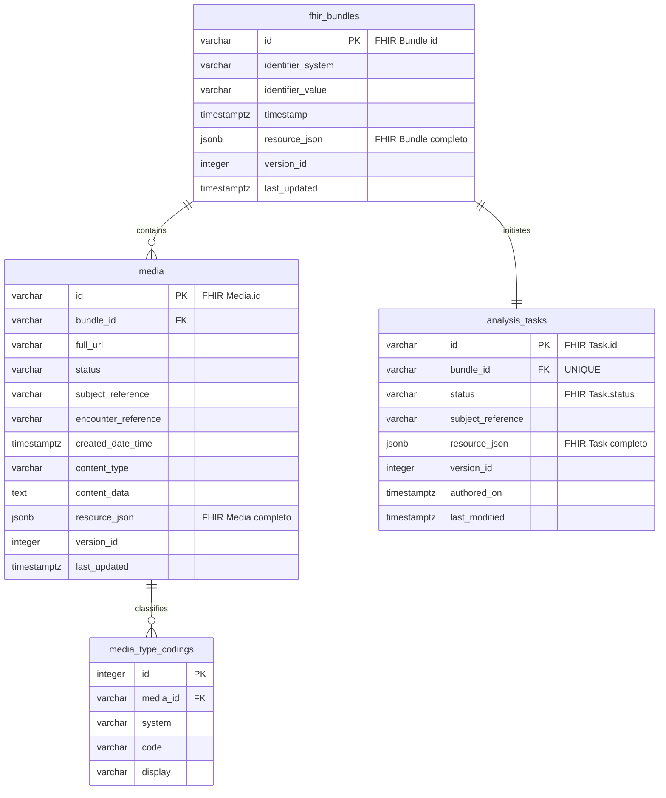

# HealPlus FHIR R4 Image Intake API

API de intake de fotografias clínicas JPEG para análise assíncrona. A interface
implementa um subconjunto declarado do FHIR R4 e usa recursos `Parameters`,
`Bundle`, `Media`, `Task` e `OperationOutcome`.

## Operação de intake

```http
POST /api/fhir/r4/$submit-media
Content-Type: application/fhir+json
Accept: application/fhir+json
Prefer: respond-async
```

O corpo é um recurso FHIR `Parameters` com exatamente um parâmetro `bundle`.
O recurso desse parâmetro é um `Bundle` do tipo `collection`, contendo uma ou
mais entradas `Media`.

```json
{
  "resourceType": "Parameters",
  "parameter": [
    {
      "name": "bundle",
      "resource": {
        "resourceType": "Bundle",
        "type": "collection",
        "entry": [
          {
            "fullUrl": "urn:uuid:media-001",
            "resource": {
              "resourceType": "Media",
              "id": "media-001",
              "status": "completed",
              "type": {
                "coding": [
                  {
                    "system": "http://terminology.hl7.org/CodeSystem/media-type",
                    "code": "image"
                  }
                ]
              },
              "subject": {
                "reference": "Patient/12345"
              },
              "encounter": {
                "reference": "Encounter/67890"
              },
              "createdDateTime": "2026-09-21T10:15:00Z",
              "content": {
                "contentType": "image/jpeg",
                "data": "/9j/4AAQ"
              }
            }
          }
        ]
      }
    }
  ]
}
```

Uma submissão aceita retorna `202 Accepted`, o header
`Content-Location: /api/fhir/r4/Task/{id}` e um recurso FHIR `Task` com
`status = accepted`. Como a operação é assíncrona, o header
`Prefer: respond-async` é obrigatório.

## Estados da análise

O estado da análise é sempre o código nativo de `Task.status`: `draft`,
`requested`, `received`, `accepted`, `rejected`, `ready`, `cancelled`,
`in-progress`, `on-hold`, `failed`, `completed` ou `entered-in-error`.

## Recursos disponíveis

- `GET /api/fhir/r4/Task/{id}`
- `GET /api/fhir/r4/Bundle/{id}`
- `GET /api/fhir/r4/Media/{id}`
- `GET /api/fhir/r4/metadata`
- `GET /api/fhir/r4/OperationDefinition/submit-media`
- `GET /api/fhir/r4/StructureDefinition/{profile-id}`

Os perfis publicados são `healplus-media`, `healplus-image-intake-bundle` e
`healplus-analysis-task`.

Falhas nas rotas FHIR são retornadas como recursos `OperationOutcome` com o
media type negociado `application/fhir+json` ou `application/json`. Recursos
recuperados incluem `ETag` e `Last-Modified`; clientes podem usar
`If-None-Match` ou `If-Modified-Since` para leitura condicional.

## Especificações FHIR R4 implementadas

| Especificação | Implementação no HealPlus |
|---|---|
| [RESTful API e formatos](https://hl7.org/fhir/R4/http.html) | Base `/api/fhir/r4`, JSON FHIR, negociação por `Accept`, `Content-Type: application/fhir+json`, versionamento HTTP e leitura condicional. |
| [Operações FHIR](https://hl7.org/fhir/R4/operations.html) | Operação de sistema `POST /api/fhir/r4/$submit-media`, documentada por `OperationDefinition`, com entrada `Parameters` e retorno `Task`. |
| [Padrão assíncrono](https://hl7.org/fhir/R4/async.html) | `Prefer: respond-async`, resposta `202 Accepted`, `Content-Location` e `Retry-After` para consulta posterior da análise. |
| [Bundle](https://hl7.org/fhir/R4/bundle.html) | Recebimento de `Bundle.type = collection`, múltiplas entradas `Media`, validação de `fullUrl` único e preservação do recurso original. |
| [Media](https://hl7.org/fhir/R4/media.html) | Imagens clínicas JPEG em `Attachment.data` Base64, `subject`, `encounter`, data de criação, tipo de mídia e metadados clínicos aplicáveis. |
| [Task](https://hl7.org/fhir/R4/task.html) | Acompanhamento assíncrono da análise com os códigos nativos de `Task.status`, `focus` para o Bundle e `for` para o paciente. |
| [OperationOutcome](https://hl7.org/fhir/R4/operationoutcome.html) | Erros de validação, conteúdo, conflito, recurso inexistente e indisponibilidade retornados como recursos FHIR estruturados. |
| [CapabilityStatement](https://hl7.org/fhir/R4/capabilitystatement.html) | Publicação das capacidades do servidor em `GET /api/fhir/r4/metadata`. |
| [Profiles e StructureDefinition](https://hl7.org/fhir/R4/profiling.html) | Perfis HealPlus para `Media`, `Bundle` e `Task`, publicados como `StructureDefinition` e identificados em `meta.profile`. |

As referências acima correspondem à versão **FHIR R4 4.0.1**. Os perfis
HealPlus restringem o padrão base ao cenário de intake de fotografias clínicas;
eles não substituem perfis nacionais ou de outras organizações.

## Modelo entidade-relacionamento



Um `Bundle` contém uma ou mais `Media`; cada `Media` pode ter múltiplos
`Coding` em `Media.type.coding`. Cada Bundle submetido inicia exatamente uma
`Task` de análise, garantida pela restrição `UNIQUE` em `analysis_tasks.bundle_id`.
Os documentos FHIR originais são preservados nas colunas `resource_json`, enquanto
as colunas relacionais suportam consulta, integridade referencial e processamento.

## Desenvolvimento

### Pré-requisitos

- Python 3.12 ou superior;
- [uv](https://docs.astral.sh/uv/);
- Docker com Docker Compose v2.

### Inicialização local

Use o fluxo abaixo para preparar o ambiente local. `docker compose up -d --wait`
é a forma recomendada de iniciar o PostgreSQL: ele sobe o serviço em segundo
plano e aguarda o `healthcheck` concluir antes de continuar.

```bash
# Instala as dependências da aplicação e de desenvolvimento.
uv sync --all-groups

# Cria o arquivo local de configuração do banco.
cp .env.example .env

# Inicia o PostgreSQL 16 e espera o banco ficar saudável.
docker compose up -d --wait

# Cria/atualiza o esquema FHIR no banco.
uv run alembic upgrade head

# Inicia a API em modo de desenvolvimento.
uv run fastapi dev src/healplus_intake_image_api/main.py
```

A API estará disponível em `http://127.0.0.1:8000`, e a documentação OpenAPI
em `http://127.0.0.1:8000/docs`.

O Compose expõe o PostgreSQL em `localhost:5432` com o banco `healplus`, usuário
`healplus` e senha de desenvolvimento `healplus_dev`. A `DATABASE_URL` padrão
em `.env.example` já corresponde a esses valores.

### Comandos usuais

```bash
# Ver os containers e acompanhar os logs do banco.
docker compose ps
docker compose logs -f postgres

# Conferir a versão de migração aplicada.
uv run alembic current

# Executar os testes.
uv run pytest -q

# Parar o banco, preservando os dados no volume Docker.
docker compose down
```

### Testes

Os testes automatizados usam SQLite em memória e não exigem que o PostgreSQL ou
o Docker Compose estejam em execução.

```bash
# Executa toda a suíte.
uv sync --all-groups
uv run pytest -q

# Executa somente os testes do intake FHIR.
uv run pytest -q tests/test_fhir_image_intake.py

# Executa um único cenário.
uv run pytest -q \
  tests/test_fhir_image_intake.py::test_submit_media_persists_fhir_resources
```

Para reiniciar o banco local do zero, remova explicitamente o volume e repita a
inicialização:

```bash
docker compose down -v
docker compose up -d --wait
uv run alembic upgrade head
```
