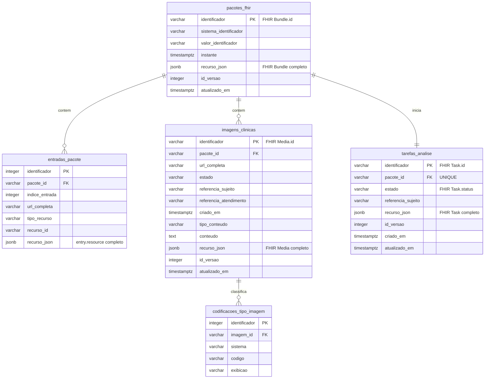

# API HealPlus de Avaliação de Feridas FHIR R4

API de intake de avaliação clínica de feridas para análise assíncrona. A
interface implementa um subconjunto declarado do FHIR R4 com envelope
`Parameters` e `Bundle` (`collection`) contendo recursos clínicos da avaliação.

## Operação de intake clínico

```http
POST /api/fhir/r4/$avaliar-feridas
Content-Type: application/fhir+json
Accept: application/fhir+json
Prefer: respond-async
```

O corpo é um recurso FHIR `Parameters` com exatamente um parâmetro `bundle`.
O recurso desse parâmetro é um `Bundle` do tipo `collection`, contendo os
recursos clínicos da avaliação:

- 1 `Patient`
- 1 `Practitioner`
- 1 `Encounter`
- 1 `Condition` da ferida avaliada
- 1 `Provenance`
- >= 1 `Media`
- `Observation` com códigos obrigatórios:
  `dimensoes-ferida`, `tecido-ferida`, `sinais-infeccao-ferida`,
  `exsudato-ferida`, `bordas-ferida`, `pele-perilesional`,
  `qualidade-captura-imagem`

```json
{
  "resourceType": "Parameters",
  "parameter": [
    {
      "name": "bundle",
      "resource": {
        "resourceType": "Bundle",
        "id": "assessment-001",
        "type": "collection",
        "entry": [
          {
            "fullUrl": "urn:uuid:10000000-0000-1000-8000-000000000001",
            "resource": {
              "resourceType": "Patient",
              "id": "patient-001",
              "identifier": [
                {
                  "system": "https://healplus.com.br/fhir/NamingSystem/paciente",
                  "value": "PSEUD-00001"
                }
              ]
            }
          },
          {
            "fullUrl": "urn:uuid:20000000-0000-4000-8000-000000000001",
            "resource": {
              "resourceType": "Practitioner",
              "id": "practitioner-001",
              "identifier": [
                {
                  "system": "https://healplus.com.br/fhir/NamingSystem/profissional",
                  "value": "PROF-00001"
                }
              ]
            }
          },
          {
            "fullUrl": "urn:uuid:30000000-0000-4000-8000-000000000001",
            "resource": {
              "resourceType": "Encounter",
              "id": "encounter-001",
              "status": "finished",
              "class": {
                "system": "http://terminology.hl7.org/CodeSystem/v3-ActCode",
                "code": "AMB"
              },
              "subject": {
                "reference": "urn:uuid:10000000-0000-1000-8000-000000000001"
              },
              "period": {
                "start": "2026-10-19T21:50:00Z"
              },
              "participant": [
                {
                  "individual": {
                    "reference": "urn:uuid:20000000-0000-4000-8000-000000000001"
                  }
                }
              ]
            }
          },
          {
            "fullUrl": "urn:uuid:40000000-0000-4000-8000-000000000001",
            "resource": {
              "resourceType": "Condition",
              "id": "wound-001",
              "clinicalStatus": {
                "coding": [
                  {
                    "system": "http://terminology.hl7.org/CodeSystem/condition-clinical",
                    "code": "active"
                  }
                ]
              },
              "verificationStatus": {
                "coding": [
                  {
                    "system": "http://terminology.hl7.org/CodeSystem/condition-ver-status",
                    "code": "confirmed"
                  }
                ]
              },
              "category": [
                {
                  "coding": [
                    {
                      "system": "https://healplus.com.br/fhir/CodeSystem/categoria-condicao",
                      "code": "ferida"
                    }
                  ]
                }
              ],
              "code": {
                "coding": [
                  {
                    "system": "https://healplus.com.br/fhir/CodeSystem/tipo-ferida",
                    "code": "ulcera-venosa"
                  }
                ]
              },
              "subject": {
                "reference": "urn:uuid:10000000-0000-1000-8000-000000000001"
              },
              "encounter": {
                "reference": "urn:uuid:30000000-0000-4000-8000-000000000001"
              },
              "recordedDate": "2026-10-19T22:00:00Z",
              "recorder": {
                "reference": "urn:uuid:20000000-0000-4000-8000-000000000001"
              },
              "bodySite": [
                {
                  "coding": [
                    {
                      "system": "https://healplus.com.br/fhir/CodeSystem/localizacao-anatomica",
                      "code": "maleolo-medial-esquerdo"
                    }
                  ]
                }
              ]
            }
          },
          {
            "fullUrl": "urn:uuid:50000000-0000-4000-8000-000000000001",
            "resource": {
              "resourceType": "Media",
              "id": "media-001",
              "status": "completed",
              "type": {
                "coding": [
                  {
                    "system": "http://terminology.hl7.org/CodeSystem/media-type",
                    "code": "image"
                  }
                ]
              },
              "subject": {
                "reference": "urn:uuid:10000000-0000-1000-8000-000000000001"
              },
              "encounter": {
                "reference": "urn:uuid:30000000-0000-4000-8000-000000000001"
              },
              "createdDateTime": "2026-10-19T21:55:00Z",
              "operator": {
                "reference": "urn:uuid:20000000-0000-4000-8000-000000000001"
              },
              "bodySite": {
                "coding": [
                  {
                    "system": "https://healplus.com.br/fhir/CodeSystem/localizacao-anatomica",
                    "code": "maleolo-medial-esquerdo"
                  }
                ]
              },
              "content": {
                "contentType": "image/jpeg",
                "data": "/9j/4AAQ"
              }
            }
          },
          {
            "fullUrl": "urn:uuid:60000000-0000-4000-8000-000000000001",
            "resource": {
              "resourceType": "Observation",
              "id": "obs-dimensoes",
              "status": "final",
              "category": [{"coding": [{"system": "http://terminology.hl7.org/CodeSystem/observation-category", "code": "exam"}]}],
              "code": {"coding": [{"system": "https://healplus.com.br/fhir/CodeSystem/avaliacao-ferida", "code": "dimensoes-ferida"}]},
              "subject": {"reference": "urn:uuid:10000000-0000-1000-8000-000000000001"},
              "encounter": {"reference": "urn:uuid:30000000-0000-4000-8000-000000000001"},
              "focus": [{"reference": "urn:uuid:40000000-0000-4000-8000-000000000001"}],
              "effectiveDateTime": "2026-10-19T22:00:00Z",
              "issued": "2026-10-19T22:10:00Z",
              "performer": [{"reference": "urn:uuid:20000000-0000-4000-8000-000000000001"}],
              "bodySite": {"coding": [{"code": "maleolo-medial-esquerdo"}]},
              "derivedFrom": [{"reference": "urn:uuid:50000000-0000-4000-8000-000000000001"}]
            }
          },
          {
            "fullUrl": "urn:uuid:60000000-0000-4000-8000-000000000002",
            "resource": {
              "resourceType": "Observation",
              "id": "obs-tecido",
              "status": "final",
              "category": [{"coding": [{"system": "http://terminology.hl7.org/CodeSystem/observation-category", "code": "exam"}]}],
              "code": {"coding": [{"system": "https://healplus.com.br/fhir/CodeSystem/avaliacao-ferida", "code": "tecido-ferida"}]},
              "subject": {"reference": "urn:uuid:10000000-0000-1000-8000-000000000001"},
              "encounter": {"reference": "urn:uuid:30000000-0000-4000-8000-000000000001"},
              "focus": [{"reference": "urn:uuid:40000000-0000-4000-8000-000000000001"}],
              "effectiveDateTime": "2026-10-19T22:00:00Z",
              "issued": "2026-10-19T22:10:00Z",
              "performer": [{"reference": "urn:uuid:20000000-0000-4000-8000-000000000001"}],
              "bodySite": {"coding": [{"code": "maleolo-medial-esquerdo"}]}
            }
          },
          {
            "fullUrl": "urn:uuid:60000000-0000-4000-8000-000000000003",
            "resource": {
              "resourceType": "Observation",
              "id": "obs-infeccao",
              "status": "final",
              "category": [{"coding": [{"system": "http://terminology.hl7.org/CodeSystem/observation-category", "code": "exam"}]}],
              "code": {"coding": [{"system": "https://healplus.com.br/fhir/CodeSystem/avaliacao-ferida", "code": "sinais-infeccao-ferida"}]},
              "subject": {"reference": "urn:uuid:10000000-0000-1000-8000-000000000001"},
              "encounter": {"reference": "urn:uuid:30000000-0000-4000-8000-000000000001"},
              "focus": [{"reference": "urn:uuid:40000000-0000-4000-8000-000000000001"}],
              "effectiveDateTime": "2026-10-19T22:00:00Z",
              "issued": "2026-10-19T22:10:00Z",
              "performer": [{"reference": "urn:uuid:20000000-0000-4000-8000-000000000001"}],
              "bodySite": {"coding": [{"code": "maleolo-medial-esquerdo"}]}
            }
          },
          {
            "fullUrl": "urn:uuid:60000000-0000-4000-8000-000000000004",
            "resource": {
              "resourceType": "Observation",
              "id": "obs-exsudato",
              "status": "final",
              "category": [{"coding": [{"system": "http://terminology.hl7.org/CodeSystem/observation-category", "code": "exam"}]}],
              "code": {"coding": [{"system": "https://healplus.com.br/fhir/CodeSystem/avaliacao-ferida", "code": "exsudato-ferida"}]},
              "subject": {"reference": "urn:uuid:10000000-0000-1000-8000-000000000001"},
              "encounter": {"reference": "urn:uuid:30000000-0000-4000-8000-000000000001"},
              "focus": [{"reference": "urn:uuid:40000000-0000-4000-8000-000000000001"}],
              "effectiveDateTime": "2026-10-19T22:00:00Z",
              "issued": "2026-10-19T22:10:00Z",
              "performer": [{"reference": "urn:uuid:20000000-0000-4000-8000-000000000001"}],
              "bodySite": {"coding": [{"code": "maleolo-medial-esquerdo"}]}
            }
          },
          {
            "fullUrl": "urn:uuid:60000000-0000-4000-8000-000000000005",
            "resource": {
              "resourceType": "Observation",
              "id": "obs-bordas",
              "status": "final",
              "category": [{"coding": [{"system": "http://terminology.hl7.org/CodeSystem/observation-category", "code": "exam"}]}],
              "code": {"coding": [{"system": "https://healplus.com.br/fhir/CodeSystem/avaliacao-ferida", "code": "bordas-ferida"}]},
              "subject": {"reference": "urn:uuid:10000000-0000-1000-8000-000000000001"},
              "encounter": {"reference": "urn:uuid:30000000-0000-4000-8000-000000000001"},
              "focus": [{"reference": "urn:uuid:40000000-0000-4000-8000-000000000001"}],
              "effectiveDateTime": "2026-10-19T22:00:00Z",
              "issued": "2026-10-19T22:10:00Z",
              "performer": [{"reference": "urn:uuid:20000000-0000-4000-8000-000000000001"}],
              "bodySite": {"coding": [{"code": "maleolo-medial-esquerdo"}]}
            }
          },
          {
            "fullUrl": "urn:uuid:60000000-0000-4000-8000-000000000006",
            "resource": {
              "resourceType": "Observation",
              "id": "obs-pele",
              "status": "final",
              "category": [{"coding": [{"system": "http://terminology.hl7.org/CodeSystem/observation-category", "code": "exam"}]}],
              "code": {"coding": [{"system": "https://healplus.com.br/fhir/CodeSystem/avaliacao-ferida", "code": "pele-perilesional"}]},
              "subject": {"reference": "urn:uuid:10000000-0000-1000-8000-000000000001"},
              "encounter": {"reference": "urn:uuid:30000000-0000-4000-8000-000000000001"},
              "focus": [{"reference": "urn:uuid:40000000-0000-4000-8000-000000000001"}],
              "effectiveDateTime": "2026-10-19T22:00:00Z",
              "issued": "2026-10-19T22:10:00Z",
              "performer": [{"reference": "urn:uuid:20000000-0000-4000-8000-000000000001"}],
              "bodySite": {"coding": [{"code": "maleolo-medial-esquerdo"}]}
            }
          },
          {
            "fullUrl": "urn:uuid:60000000-0000-4000-8000-000000000007",
            "resource": {
              "resourceType": "Observation",
              "id": "obs-qualidade",
              "status": "final",
              "category": [{"coding": [{"system": "http://terminology.hl7.org/CodeSystem/observation-category", "code": "exam"}]}],
              "code": {"coding": [{"system": "https://healplus.com.br/fhir/CodeSystem/avaliacao-ferida", "code": "qualidade-captura-imagem"}]},
              "subject": {"reference": "urn:uuid:10000000-0000-1000-8000-000000000001"},
              "encounter": {"reference": "urn:uuid:30000000-0000-4000-8000-000000000001"},
              "focus": [{"reference": "urn:uuid:40000000-0000-4000-8000-000000000001"}],
              "effectiveDateTime": "2026-10-19T22:00:00Z",
              "issued": "2026-10-19T22:10:00Z",
              "performer": [{"reference": "urn:uuid:20000000-0000-4000-8000-000000000001"}],
              "bodySite": {"coding": [{"code": "maleolo-medial-esquerdo"}]},
              "derivedFrom": [{"reference": "urn:uuid:50000000-0000-4000-8000-000000000001"}]
            }
          },
          {
            "fullUrl": "urn:uuid:70000000-0000-4000-8000-000000000001",
            "resource": {
              "resourceType": "Provenance",
              "id": "provenance-001",
              "target": [
                {"reference": "urn:uuid:30000000-0000-4000-8000-000000000001"},
                {"reference": "urn:uuid:40000000-0000-4000-8000-000000000001"},
                {"reference": "urn:uuid:50000000-0000-4000-8000-000000000001"},
                {"reference": "urn:uuid:60000000-0000-4000-8000-000000000001"}
              ],
              "recorded": "2026-10-19T22:10:00Z",
              "activity": {
                "coding": [
                  {
                    "code": "captura-dados-clinicos"
                  }
                ]
              },
              "agent": [
                {
                  "type": {
                    "coding": [
                      {
                        "code": "author"
                      }
                    ]
                  },
                  "who": {
                    "reference": "urn:uuid:20000000-0000-4000-8000-000000000001"
                  }
                }
              ]
            }
          }
        ]
      }
    }
  ]
}
```

O payload contém dados pseudonimizados e uma imagem JPEG Base64 mínima para
fins de exemplo. Substitua-os por dados clinicamente válidos e por uma imagem
JPEG codificada em Base64 antes do uso em produção.

Uma submissão aceita retorna `202 Accepted`, o header
`Content-Location: /api/fhir/r4/Task/{id}` e um recurso FHIR `Task` com
`status = accepted`. O header `Prefer: respond-async` é opcional; quando
informado, deve conter o valor `respond-async`.

No Swagger UI (`/docs`), o corpo da operação é publicado como
`application/fhir+json`, portanto o `Content-Type` é definido automaticamente.
O header `Prefer` também está disponível como campo opcional. Use
`Accept: application/fhir+json` para receber uma resposta FHIR JSON; a API
também aceita `application/json`.

## Estados da análise

O estado da análise é sempre o código nativo de `Task.status`: `draft`,
`requested`, `received`, `accepted`, `rejected`, `ready`, `cancelled`,
`in-progress`, `on-hold`, `failed`, `completed` ou `entered-in-error`.

## Recursos disponíveis

- `GET /api/fhir/r4/Task/{id}`
- `GET /api/fhir/r4/Bundle/{id}`
- `GET /api/fhir/r4/Media/{id}`
- `GET /api/fhir/r4/Encounter/{id}`
- `GET /api/fhir/r4/Condition/{id}`
- `GET /api/fhir/r4/Observation/{id}`
- `GET /api/fhir/r4/metadata`
- `GET /api/fhir/r4/OperationDefinition/avaliar-feridas`
- `GET /api/fhir/r4/StructureDefinition/{profile-id}`

Os perfis publicados incluem:
`HealPlusAvaliacaoFerida`, `HealPlusPaciente`, `HealPlusProfissional`,
`HealPlusDispositivoAnalise`, `HealPlusAtendimentoAvaliacaoFerida`,
`HealPlusFerida`, `HealPlusImagemClinica`, `HealPlusProvenienciaAvaliacao`,
`HealPlusDimensoesFerida`, `HealPlusTecidoFerida`,
`HealPlusSinaisInfeccaoFerida`, `HealPlusExsudatoFerida`,
`HealPlusDorFerida`, `HealPlusBordasFerida`,
`HealPlusPelePerilesional`, `HealPlusQualidadeCapturaImagem` e
`HealPlusTarefaAnalise`.

Falhas nas rotas FHIR são retornadas como recursos `OperationOutcome` com o
media type negociado `application/fhir+json` ou `application/json`. Recursos
recuperados incluem `ETag` e `Last-Modified`; clientes podem usar
`If-None-Match` ou `If-Modified-Since` para leitura condicional.

## Especificações FHIR R4 implementadas

| Especificação | Implementação no HealPlus |
|---|---|
| [RESTful API e formatos](https://hl7.org/fhir/R4/http.html) | Base `/api/fhir/r4`, JSON FHIR, negociação por `Accept`, `Content-Type: application/fhir+json`, versionamento HTTP e leitura condicional. |
| [Operações FHIR](https://hl7.org/fhir/R4/operations.html) | Operação de sistema `POST /api/fhir/r4/$avaliar-feridas`, documentada por `OperationDefinition`, com entrada `Parameters` e retorno `Task`. |
| [Padrão assíncrono](https://hl7.org/fhir/R4/async.html) | `Prefer: respond-async` opcional, resposta `202 Accepted`, `Content-Location` e `Retry-After` para consulta posterior da análise. |
| [Bundle](https://hl7.org/fhir/R4/bundle.html) | Recebimento de `Bundle.type = collection` com recursos clínicos tipados, validação de `fullUrl` único e preservação do recurso original. |
| [Media](https://hl7.org/fhir/R4/media.html) | Imagens clínicas JPEG em `Attachment.data` Base64, `subject`, `encounter`, data de criação, tipo de mídia e metadados clínicos aplicáveis. |
| [Task](https://hl7.org/fhir/R4/task.html) | Acompanhamento assíncrono da análise com os códigos nativos de `Task.status`, `focus` para o Bundle e `for` para o paciente. |
| [OperationOutcome](https://hl7.org/fhir/R4/operationoutcome.html) | Erros de validação, conteúdo, conflito, recurso inexistente e indisponibilidade retornados como recursos FHIR estruturados. |
| [CapabilityStatement](https://hl7.org/fhir/R4/capabilitystatement.html) | Publicação das capacidades do servidor em `GET /api/fhir/r4/metadata`. |
| [Profiles e StructureDefinition](https://hl7.org/fhir/R4/profiling.html) | Perfis HealPlus publicados para `Bundle`, `Patient`, `Practitioner`, `Device`, `Encounter`, `Condition`, `Media`, `Observation`, `Provenance` e `Task`, expostos em `StructureDefinition`. |

As referências acima correspondem à versão **FHIR R4 4.0.1**. Os perfis
HealPlus restringem o padrão base ao cenário de intake de fotografias clínicas;
eles não substituem perfis nacionais ou de outras organizações.

## Modelo entidade-relacionamento



Cada `Bundle` submetido inicia exatamente uma `Task` de análise (restrição
`UNIQUE` em `tarefas_analise.pacote_id`), armazena uma ou mais `Media` e
preserva todas as entradas em `entradas_pacote` para rastreabilidade clínica.
Os documentos FHIR originais são preservados nas colunas `recurso_json`,
enquanto as colunas relacionais suportam consulta e integridade.

## Status atual da implementação

- Contrato clínico FHIR ativo em `POST /api/fhir/r4/$avaliar-feridas`, com
  validação estrutural e semântica do Bundle clínico.
- OpenAPI e Swagger UI publicam o corpo da operação como
  `application/fhir+json`; `Prefer` é um header opcional e, quando enviado,
  precisa incluir `respond-async`.
- Persistência implementada para `Bundle`, `Media`, `Task` e armazenamento
  estruturado de entradas do Bundle em `entradas_pacote`.
- Conformance publicada em `metadata`, `OperationDefinition` e
  `StructureDefinition` dos perfis HealPlus do escopo clínico.
- Suíte automatizada atual: `13` testes de integração passando (`pytest -q`).
- A modelagem relacional clínica completa descrita no
  `FHIR_CLINICAL_REQUIREMENTS_MAPPING.md` (tabelas dedicadas para paciente,
  profissional, atendimento, condição, observações e proveniência) permanece
  como evolução incremental.

## Desenvolvimento

### Pré-requisitos

- Python 3.12 ou superior;
- [uv](https://docs.astral.sh/uv/);
- Docker com Docker Compose v2.

### Inicialização local

Use o fluxo abaixo para preparar o ambiente local. `docker compose up -d --wait`
é a forma recomendada de iniciar o PostgreSQL: ele sobe o serviço em segundo
plano e aguarda o `healthcheck` concluir antes de continuar.

```bash
# Instala as dependências da aplicação e de desenvolvimento.
uv sync --all-groups

# Cria o arquivo local de configuração do banco.
cp .env.example .env

# Inicia o PostgreSQL 16 e espera o banco ficar saudável.
docker compose up -d --wait

# Cria/atualiza o esquema FHIR no banco.
uv run alembic upgrade head

# Inicia a API em modo de desenvolvimento.
uv run fastapi dev src/healplus_intake_image_api/main.py
```

A API estará disponível em `http://127.0.0.1:8000`, e a documentação OpenAPI
em `http://127.0.0.1:8000/docs`.

O Compose expõe o PostgreSQL em `localhost:5432` com o banco `healplus`, usuário
`healplus` e senha de desenvolvimento `healplus_dev`. A `DATABASE_URL` padrão
em `.env.example` já corresponde a esses valores.

### Comandos usuais

```bash
# Ver os containers e acompanhar os logs do banco.
docker compose ps
docker compose logs -f postgres

# Conferir a versão de migração aplicada.
uv run alembic current

# Executar os testes.
uv run pytest -q

# Parar o banco, preservando os dados no volume Docker.
docker compose down
```

### Testes

Os testes automatizados usam SQLite em memória e não exigem que o PostgreSQL ou
o Docker Compose estejam em execução.

```bash
# Executa toda a suíte.
uv sync --all-groups
uv run pytest -q

# Executa somente os testes do intake FHIR.
uv run pytest -q tests/test_fhir_avaliacao_ferida.py

# Executa um único cenário.
uv run pytest -q \
  tests/test_fhir_avaliacao_ferida.py::test_submit_wound_assessment_persists_fhir_resources
```

Para reiniciar o banco local do zero, remova explicitamente o volume e repita a
inicialização:

```bash
docker compose down -v
docker compose up -d --wait
uv run alembic upgrade head
```
